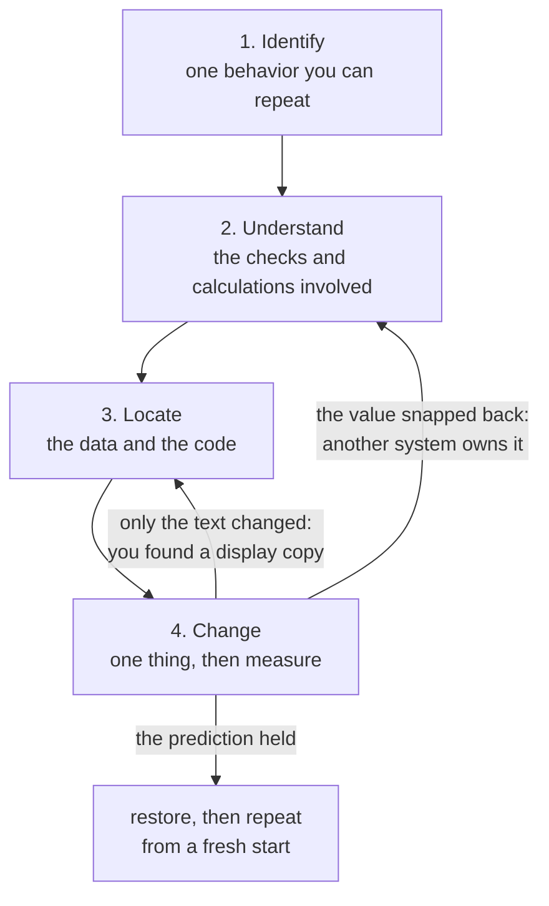
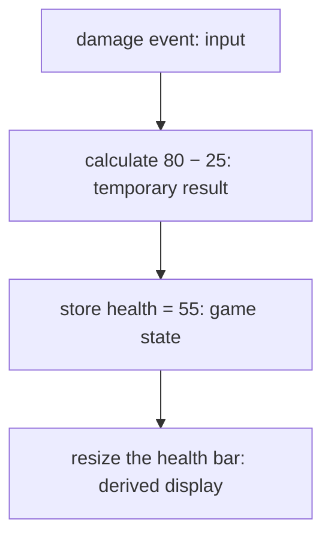
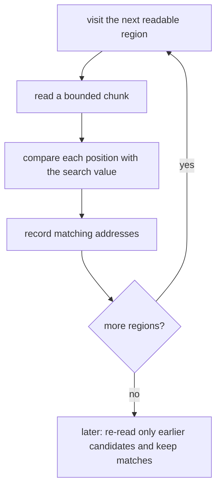

import PredictReveal from '../../../../components/PredictReveal.astro';
import CellFrames from '../../../../components/CellFrames.astro';
import { coinExperimentCells } from '../../../../data/figures-c1';
import { SpeedType, Steps } from '../../../../components/kit';
import MemoryStrip from '../../../../components/MemoryStrip.astro';
import Scene from '../../../../components/Scene.astro';
import CodeTrace from '../../../../components/CodeTrace.astro';
import MarginNote from '../../../../components/kit/MarginNote.astro';

Imagine an offline game whose display shows 100 gold. Buying an item for
25 changes the display to 75. The screen shows the result, but it does
not identify the affordability check, subtraction, or
stored value that caused it. **Game hacking** in this book means
investigating that behavior and making a deliberate, testable change to
the game or its data.

## Start with evidence, not a scan result

An observation is what you can actually see: after a 25-gold purchase,
the display changes from 100 to 75. An explanation is a **hypothesis**:
perhaps a four-byte value in the game's memory stores the gold used by
the purchase handler. Other explanations are possible. The game may keep a
display copy, recalculate gold from other data, or let a server decide
the result. A matching number is therefore a candidate, not a conclusion.

<CodeTrace trace="scene-controlled-experiment" />

<Scene name="controlled-experiment" />

The fastest way to get completely lost is to open a memory scanner and
start searching before deciding what you are asking. You can end up with
hundreds of addresses—numbered locations in the game's running memory—with
no way to tell which matters and no record of
which ones you have ruled out. A scanner finds values that match a
question; a debugger can later show the instruction that reads or writes
a candidate. Neither tool supplies the meaning by itself.

<MarginNote kind="brief">A match is only a candidate. Decide your question first, because scanners and debuggers find things but do not explain them.</MarginNote>

## Four steps for a controlled experiment

One way to keep the work in order is to split it into four steps. Treat them as
a useful order to adapt when new evidence changes the question:

<Steps>

1. **Identify** the exact behavior.
2. **Understand** how that behavior should work.
3. **Locate** the data and code involved.
4. **Change** one thing and measure the result.

</Steps>

The steps can repeat. A failed change often sends you back to improve what you
understand or locate a different copy:



## 1. Identify the behavior

Choose something you can observe and reproduce.

❌ “Find player stuff.”

✅ “Find the value that decreases by exactly 25 when the local player buys one
known item.”

The behavior is only repeatable if it starts from the same conditions each
time:

- exact game build;
- map, save, or level;
- starting value;
- action you will perform;
- result you expect to observe.

Good starting behaviors include spending gold, taking damage, moving along one
axis, or toggling one graphics setting. Avoid changing several things at once.

<CellFrames id="c1-coin-runs" title="Repeat one action from the same start" scenarios={coinExperimentCells} />

## 2. Understand how the behavior should work

Before searching memory, predict the checks and calculation the game appears to use.
For this lesson's 25-gold purchase, our first guess is:

```text
if gold >= cost:
    new_gold = gold - cost
else:
    new_gold = gold
```

Try the same idea on another behavior. For health, a first guess might be:

```text
new_health = max(0, old_health - damage)
```

A prediction can also be a condition valid state keeps, such as
`0 <= health <= max_health`.
[Lesson 14.5](/pages/13/01/#an-invariant-is-a-property-that-must-stay-true)
tests conditions like this against a running game's state.

The health calculation, stored result, and visible bar are connected,
but they need not be one stored value:



These predictions help distinguish the health used for later damage and
defeat decisions from text,
animation state, or a cached display value.

This self-contained Rust fragment makes the distinction visible:

```rust
let mut gold = 100_u32;
let displayed_gold = gold; // Copy the amount before the purchase.
if gold >= 25 {
    gold -= 25; // Change the amount the next purchase will read.
}
```

Now `displayed_gold` is still 100, but `gold` is 75. Changing the copy
would not make a later purchase use 100 gold; the next affordability check reads `gold`.
A real game may refresh its display differently, so the
experiment must establish which value the purchase handler actually reads.

At this stage these checks and formulas are hypotheses. The game may apply armor, difficulty
scaling, or delayed damage, or a server may own the result, and any of these
would break the simple formula.

## Define what your tool is allowed to do

Before code touches another process, decide its limits in a small contract.
This is a preview of the external tools built later in the book; you do
not need to implement it for the first memory experiment:

```text
Target: Wesnoth 1.14.9, 32-bit Windows build
Input: process name and expected build fingerprint
Read: one narrowed gold candidate in the current run
Change: one u32 field after confirming its current value
Stop: cancel key, version mismatch, invalid address, or failed read
Restore: write the saved original value back when the experiment ends
```

This contract prevents a small experiment from quietly turning into an
unbounded tool.

The steps also have **dependencies**: a successful write needs a successful
read of the intended field in the intended build. A failed read does not mean
the player has zero gold. Stop at that failed step and preserve its error,
rather than letting later code act on an invented value. The purchase itself
depends on the current gold and price; the display depends on an update of its
copy. Following those relationships tells you which earlier assumption to
check when a later result is wrong.

A later tool may replace the temporary address with a **module-relative
pointer path**: a sequence of lookups anchored to one exact game build.
Lesson 1.8 first explains a pointer, Lesson 2.7 explains why the
absolute address moves, and Lesson 2.8 builds the path. For
this experiment, the useful limit is simpler: verify the game build and
current value before changing anything.

## 3. Locate the data and code

Use the least complicated technique that can answer the question. A
**breakpoint** is a configured debugger stop that pauses execution at a chosen
instruction or memory access; we will use one only after learning the
debugger.

<Steps>

1. scan for the visible value;
2. make one controlled game change;
3. filter the candidate addresses;
4. repeat until the list is small;
5. later, set a breakpoint on the strongest candidate;
6. observe which instruction reads or writes it;
7. follow the stored address leading to the object and inspect nearby fields.

</Steps>

The first lab stops after scanning, filtering, and testing a candidate.
The breakpoint and object steps become practical after Chapters 2 and 3
teach the required tools and pointer model.

Inside one scan, the scanner follows an algorithm over **readable regions**:
ranges of numbered locations the operating system currently permits it to
read. It copies one limited chunk at a time:



An algorithm is a repeatable set of steps. The scanner does not know
what gold means; it compares bytes according to the value and type you
supplied. Even a small choice such as checking only every fourth byte
can miss a value starting at one of the positions between those checks.

Each controlled change throws away the candidates that did not change the same
way. The numbers below are only an example, but the shape is typical:

<MemoryStrip
  cells="first scan for 100=4,012|after spending 25 gold=37|after a second purchase=3|write breakpoint=1 instruction"
  marks="3"
  caption="Scanning narrows the addresses; a write breakpoint then names the instruction that stores to the survivor, which ties the address to the game's own code rather than to a coincidence of values."
/>

An address found once is only a candidate for that run; its object can even
disappear before the run ends. Restarting the game shows whether it is
repeatable; the module-relative path described above is what can carry over
to a new run of the same build.

Each kind of check rules out a different mistake. A second scan with a
different amount rules out an unrelated value that happened to match once. A
**write breakpoint** pauses the game when an instruction writes to a chosen
address. Chapter 2 teaches how to use one. It shows which instruction
changed the candidate; a restart shows whether the path survives a new
process.

### Find the step that actually takes time

If a scanner is slow, ask where its time goes. A **bottleneck** is the step
that limits the overall work. It might be reading another process, comparing
many values locally, sorting the remaining candidates, or writing a large log.
Finding a number and accessing its bytes are different operations, and neither
requires sorting the results unless the tool needs that order.

Measure a repeatable scan before changing its design. Record how many reads it
made, how many bytes it compared, how many matches it kept, and the time spent
in the expensive stages. Improving comparisons will do little if most time is
spent waiting for reads. Keep the first working experiment small enough to
understand; [Sampling Game State Under Load](/pages/4/08/) later handles repeated
observations and slow log writes. Larger collections and more workers are
choices to evaluate against a measured need.

## 4. Change one thing and measure the result

Make a prediction before the change:

```text
If this is the game-play gold field, changing 75 to 100 should allow a purchase
that costs more than 75, and the value should remain consistent after the next
game update.
```

Then:

<Steps>

1. save the original bytes or value so you can restore them;
2. confirm the value still matches what you expect;
3. apply one bounded change;
4. observe the immediate and next-update results;
5. restore the original state;
6. repeat from a known starting condition.

</Steps>

If only the text changes, you probably found a display copy. If the value snaps
back, another system owns or recomputes it. If unrelated fields break, your type,
width, or address may be wrong.

## Choose diagnostics that fit the failure

Compare the **expected** and **observed** result at the first step where they
diverge. Suppose you expected to read 75 before a write but actually read 74.
Investigate that mismatch before explaining the later failed purchase.

A **log** records events and values without requiring you to inspect them
immediately. A useful entry could include the operation, expected amount,
actual amount, and stage:

```text
read_gold expected=75 actual=74 stage=before_write
```

That entry explains why the tool should reject the write. For a failed process
read, record the reported error and how many bytes were read too. Keep the
target build and tool version with the run so the entry retains its meaning.

A debugger lets you pause at the suspicious step and inspect its values and
instructions. Pausing changes timing: other work may wait, or an input or
timeout may behave differently. Logging also adds work, especially when it
writes to disk. If a failure disappears when you add diagnostics, that is
evidence to investigate the timing change; it does not establish that the
underlying problem is fixed. [What a Debugger Can Reveal](/pages/2/01/) explains
the pause, while the later sampling lesson shows how to limit recording delays.

## Use tests and types for quick feedback

Separate code that decides *what should happen* from code that performs a
Windows API call. In this toy decision function, a write is allowed only when the
current value still matches the value we expected and the replacement is
at most 10,000. That limit is an example policy for this exercise, not a
universal gold limit. Pure logic like this can be tested without
launching the game:

<SpeedType id="c1-should-write" title="Recall the write check and its test values" recall={[{"text": "should_write(74, 75, 100)", "mask": "74", "kind": "argument", "hint": "A current value that no longer matches the expected 75."}, {"text": "should_write(75, 75, 10_000)", "mask": "10_000", "kind": "argument", "hint": "The largest replacement the policy still allows."}, {"text": "should_write(75, 75, 10_001)", "mask": "10_001", "kind": "argument", "hint": "The first replacement just past the limit."}, {"text": "assert!(!should_write(74, 75, 100))", "mask": "assert", "kind": "api", "hint": "The test macro that fails when its expression is false."}, {"text": "replacement <= 10_000", "mask": "<=", "kind": "logic", "hint": "Allow the limit itself, not only smaller values."}]}>

```rust
fn should_write(current: u32, expected: u32, replacement: u32) -> bool {
    // Both the expected-value check and the replacement limit must pass.
    current == expected && replacement <= 10_000
}

#[test]
fn rejects_an_unexpected_current_value() {
    // A changed field must not pass the expected-value check.
    assert!(!should_write(74, 75, 100));
}

#[test]
fn accepts_a_matching_value_and_permitted_replacement() {
    assert!(should_write(75, 75, 100));
}

#[test]
fn checks_the_replacement_limit() {
    // The limit is allowed; the next value is not.
    assert!(should_write(75, 75, 10_000));
    assert!(!should_write(75, 75, 10_001));
}
```

</SpeedType>

The first test passes because 74 is different from the expected 75, so
`should_write` returns `false`. `!` reverses that boolean, making the
assertion true. The `#[test]` marker tells Rust's test runner to call the
function, and `assert!` fails when its expression is false. The other tests
exercise a permitted write and both sides of the 10,000 limit. The
[Rust test guide](https://doc.rust-lang.org/book/ch11-01-writing-tests.html)
explains these test features. The compiler checks types, tests check examples,
and the debugger checks the running game. Each one catches mistakes the other
two cannot. This function checks the supplied sample; the game may change
again after that sample was read.
[Lesson 4.3](/pages/4/02/#validate-write-verify-and-recover) rechecks the
value immediately before a write and reads it back afterward.

Keep the smallest implementation to the contract above, with the decision
separate from process access so you can test it with ordinary values. Reuse
an existing tool or library when it supports your target and you can check
its behavior, version, error handling, and maintenance. Writing every
dependency yourself does not make the experiment more reliable.

As repeated code or new use cases appear, give each responsibility a small
interface. **Refactoring** changes the organization while preserving the
intended behavior; keep the existing examples and tests working as you do it.
[Tool Architecture, Commands, and Cleanup](/pages/8/10/) develops this separation
when several features share observations and must coordinate changes.

Review small changes as you work. A **diff** compares edited source with its
previous version, making an accidentally changed field width or missing check
easier to see. A **walkthrough** follows one example through the complete read,
decision, write, and restoration path, often with another reader. Automated
checks and these reviews answer different questions: passing a logic test does
not prove that the live address is the game's gold field.

## Leave a record another reader can repeat

Start documentation with the question, the tool's purpose, and its limits.
Then show the route through the experiment before detailing each step. A
reader needs to know which file or command to begin with, what result to
expect, and what a failure means. Define names consistently: if `gold` means
the amount used by the purchase check, call the screen copy `displayed_gold` throughout.

Keep a compact experiment record:

- **Reference environment:** game version and build identity, architecture,
  operating system, tool versions, and the save or map used.
- **Reproduction:** starting state, exact actions or commands, expected result,
  observed result, and how to restore the original state.
- **Evidence:** candidate values, relevant instructions or logs, failed checks,
  and which explanations remain possible.
- **Decisions:** why you chose this candidate, data type, limit, or dependency;
  include the observation that would make you reconsider it.

For a tool you build, document one complete supported path from a fresh source
checkout to a runnable artifact, including the compiler, target, dependency
versions, required options, and tests. Keep that path consistent with the
instructions you actually verify. Reproducible steps let another person repeat
the experiment; they do not automatically guarantee an identical executable
byte for byte. [How Source Becomes a Running Process](/pages/1/10/) explains the
build stages, and the next lab fixes the environment for this book's first scan.

Read the record from a newcomer's position. If an instruction says “use the
usual settings,” supply the settings. If a screenshot is the only record of a
result, write down the important value and condition too. Update the record
when the tool or target changes so an old address or command is not mistaken
for a current promise.

## Say how you know each claim

The record above holds statements you trust for different reasons, and the
reason decides what can be built on each one. Four kinds cover most of them:

| Kind | What makes it that kind | From the purchase |
|---|---|---|
| seen | you watched it happen | the display went from 100 to 75 |
| worked out | arithmetic on things you saw | the item cost 100 − 75 = 25 |
| guessed | an explanation no test has checked yet | the address the scan kept holds the gold the purchase check reads |
| open | a question, with the test that would answer it | which instruction writes that address? A write breakpoint on it during one purchase shows each one |

A guess becomes *seen* only when a test you ran shows it; an explanation that
merely sounds right leaves it a guess. A search that finds nothing is the claim
most often given the wrong kind, because its result covers only what it
searched.

<PredictReveal
  id="rea-empty-scan"
  setup="After the purchase you scan every readable region for the four-byte whole number 75 and get no matches."
  question="Which line belongs in the record?"
  options={[
    { label: 'Gold is not stored in memory', why: 'The scan answered a narrower question. It compared only four-byte whole numbers in the regions it could read, so gold stored any other way could never match.' },
    { label: 'No readable region held 75 as a four-byte whole number when the scan ran', correct: true, why: 'That is exactly what the scan checked, and nothing more. Every other way the game could store gold stays open until a search that looks for it runs.' },
    { label: 'The game must keep gold on a server', why: 'That is one explanation among several, and the scan says nothing about servers. It belongs in the record as a guess to test, not as a result.' },
  ]}
>

The scan compared memory with the bytes `4B 00 00 00`: 75 is `0x4B`
(4 × 16 + 11), stored lowest byte first. Gold kept as a 32-bit floating-point
number (Rust's `f32`) would be the bytes `00 00 96 42` instead, which
[How Bytes Become Numbers and Pointers](/pages/3/09/#fractions-how-an-f32-splits-its-32-bits)
works out, so a whole-number scan can never match it. A scan that checks only
every fourth position also misses a value that starts between them. Each of
those possibilities stays open until its own search runs: a scan for the `f32`
value 75.0, or one that checks every position.

</PredictReveal>

## What a candidate address tells you

A matching address is a lead. A repeatable action and a predicted check or calculation
give it meaning; controlled changes and a breakpoint narrow the lead.
A reversible edit tests whether that address changes the amount a purchase reads or
only a displayed copy. The compiler and tests check the tool's logic, while the
debugger observes what the running game actually does.

[Lesson 1.7](/pages/1/07/) prepares a repeatable Windows lab. Lesson 1.8
shows what its scanner will read, and [Lesson 1.9](/pages/1/09/) walks
through the first gold scan with screenshots. Its 15-gold recruit is a
separate game action with its own starting value and observed result.
