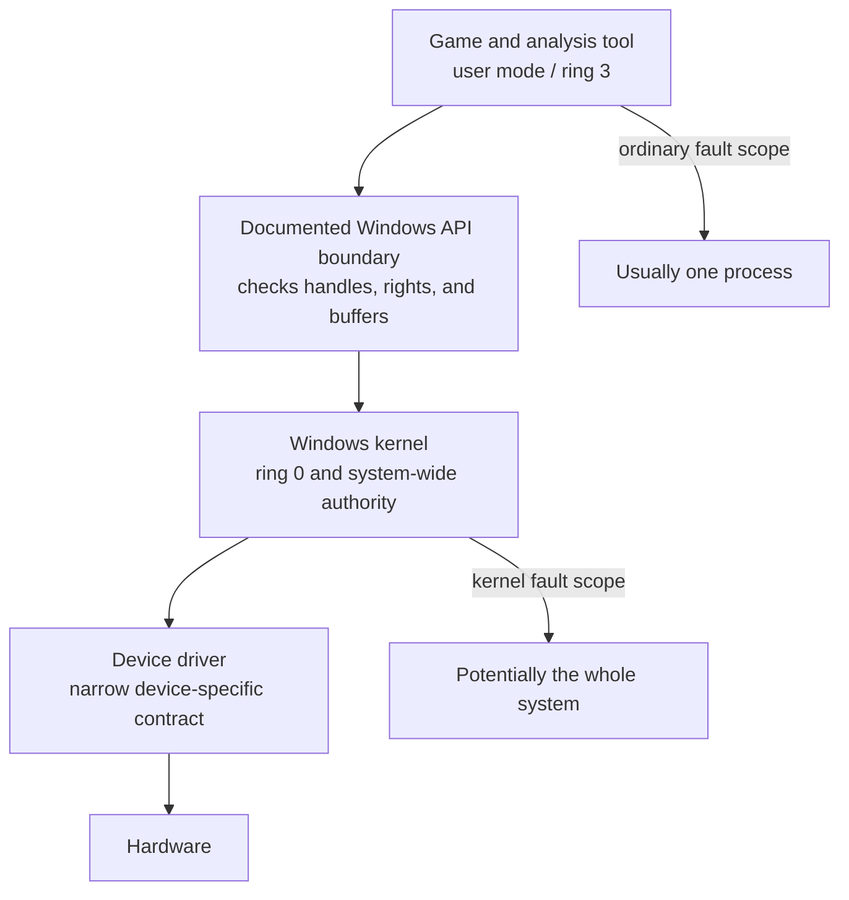
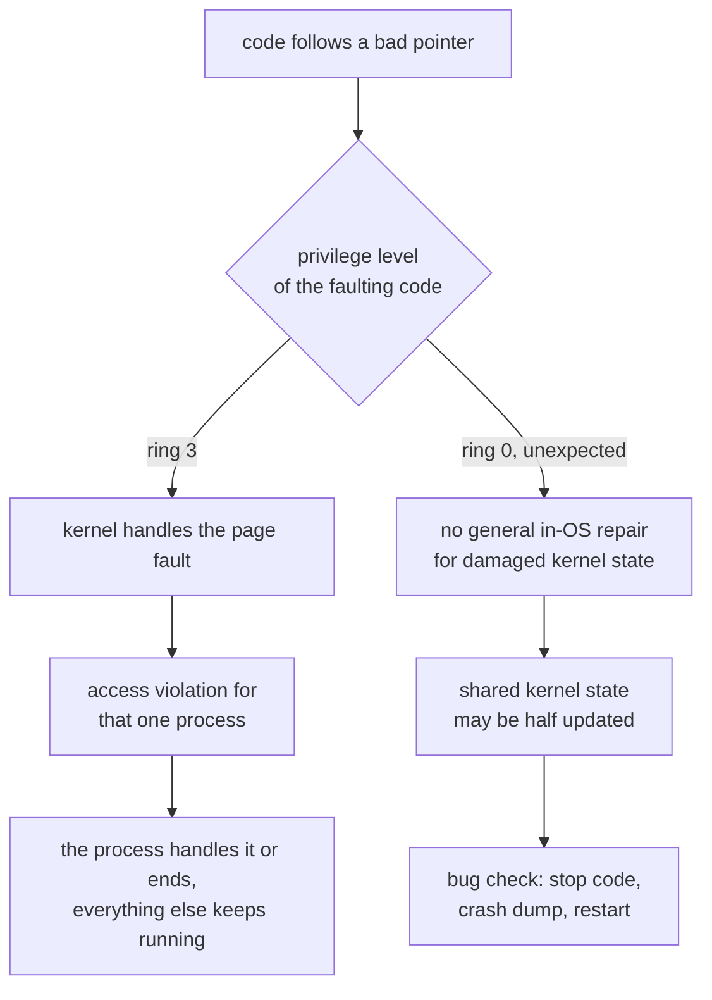
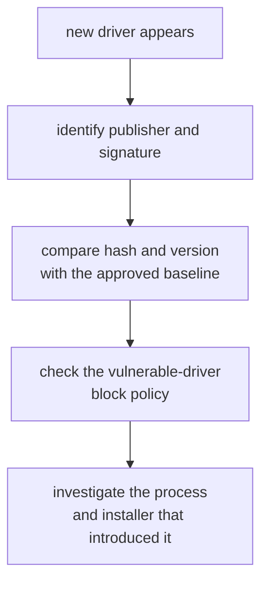
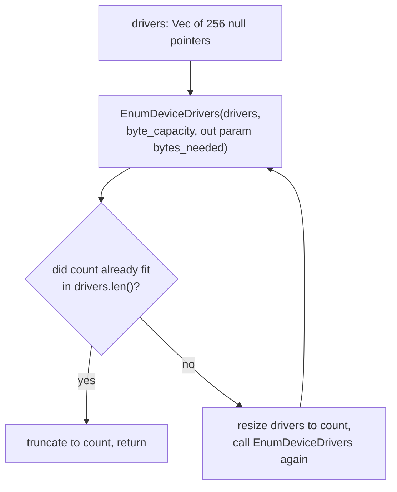

import Frame from '../../../../components/kit/Frame.astro';
import CellFrames from '../../../../components/CellFrames.astro';
import { kernelFaultCells } from '../../../../data/figure-cells-b';
import { Accordion, Badge, GitHub } from '../../../../components/kit';
import Visual from '../../../../components/Visual.astro';
import MarginNote from '../../../../components/kit/MarginNote.astro';

The DLL lessons followed identity, loading, and API resolution inside a
process. The driver lessons then followed a request through the I/O manager,
checked buffers, and device registers. We can now ask what authority those
components actually carry. A game tool's process handle grants limited access;
a kernel driver can affect the whole machine. This lesson makes that trust
boundary visible with a read-only inventory of the drivers Windows has loaded.

## Ring 3 and ring 0 in plain English

The Windows kernel is the part of the operating system trusted to manage memory, devices, processes, and security boundaries. A normal game and the tools in this book run in **user mode**, often called **ring 3**. A kernel driver runs in **kernel mode**, often called **ring 0**.

The important model is **which invariants a component can break**. User-mode code
runs with page-table and privilege checks that confine ordinary faults to its allowed
address space and handles. Kernel-mode code participates in enforcing those checks;
it can change mappings, device state, process state, and security decisions for the
whole system.

<MarginNote kind="brief">Kernel code helps enforce system-wide memory and privilege checks, so its failures can reach beyond one game process.</MarginNote>

A user-mode crash normally ends one process. A bad kernel pointer can crash the
entire computer or corrupt data belonging to any process. Moving code into a driver
therefore enlarges both its authority and the damage caused by a bug. “More
privilege” is not the same as “better engineering.”

<CellFrames id="kernel-fault-scope" title="How far a fault reaches" scenarios={kernelFaultCells} />



The boundary is useful because callers do not receive kernel authority merely
for asking Windows to do something. The kernel checks the request, and a sound
driver checks it again before touching device or privileged memory.

## Why a kernel bug takes the whole machine down

When user-mode code follows a bad pointer, the processor raises a page fault
and the kernel handles it. The kernel checks its records, finds that nothing
valid lives at that address, and turns the fault into an access-violation
exception for that one process. The program's own handler, a debugger, or
Windows Error Reporting deals with it, and in the worst case one process ends.
The kernel is the safety net under every user-mode program.

There is no separate part of Windows that can repair arbitrary damage to its
own kernel state. A hypervisor may isolate a whole guest from the host, as
Lesson 14.1 will show, but it cannot resume a guest kernel whose internal
records are already corrupted. Kernel code does catch faults it expects, such
as touching a user buffer that another thread may have freed; the copy behind
`ReadProcessMemory` is written to catch exactly those. But a driver that follows
a bad pointer by mistake can raise an unexpected fault inside the kernel, and
kernel code and drivers share an address space and a set of data
structures: the scheduler's lists, the memory manager's page records, and the
locks that guard them. The fault may have struck halfway through updating one
of those structures, with a lock still held. Windows cannot generally prove
which of its own records remain sound, and carrying on could write corrupted
data to disk. For an unrecoverable kernel failure, Windows stops on purpose.



That deliberate stop is a **bug check**, better known as the blue screen.
Windows shows a stop code, such as `0x50` PAGE_FAULT_IN_NONPAGED_AREA or `0xD1`
DRIVER_IRQL_NOT_LESS_OR_EQUAL, writes a crash dump of the whole machine if it
can ([Lesson 11.12](/pages/10/08/) will capture a dump of one process), and
restarts.

<Visual kind="fault-ring" />

Inside a virtual machine, even a bug check stops only that virtual machine
([Lesson 14.1](/pages/14/03/)), which is one more reason the book's labs run in
user mode inside a virtual machine.

## Why the course labs stay in user mode

The old open-source games in this book do not need a driver. Their offline processes can be studied with documented Windows APIs, a debugger, a user-mode DLL, and reversible patches.

The course deliberately does not build:

- arbitrary kernel or physical-memory read/write commands;
- privilege-escalation paths;
- security-product or anti-cheat bypasses;
- hidden drivers, callbacks, threads, or processes;
- loaders for vulnerable or untrusted drivers.

Those capabilities would expand the problem from studying one game process into controlling the operating system and concealing that control.

Microsoft’s own driver security guidance begins with the same design question: confirm that a kernel driver is actually required. If a service or application can do the job, it is the lower-risk boundary.

## Why Windows insists on signed drivers

Loading a driver puts new code into ring 0, so Windows checks where a driver
came from before loading it. 64-bit Windows refuses kernel-mode code without a
valid digital signature, the kind of signature [Lesson 9.8](/pages/9/07/)
checked on game files. Since Windows 10 version 1607, on a PC with Secure Boot
on, a new driver must be signed by Microsoft itself, through its hardware
developer program, which requires the publisher to prove its identity with an
extended-validation certificate. **Secure Boot** is the firmware check that
allows only signed boot components to start, which also keeps these signature
checks from being relaxed before Windows is running. Developers' test-signing
modes relax them on purpose, so they belong only on a disposable test machine,
and this book never uses them.

A signature answers two questions: who published this driver, and has it
changed since? It does not say whether the code is safe, as the next section
shows. Attackers look for old, legitimately signed drivers with an exploitable
bug and load one to borrow it. Microsoft's answer is the **vulnerable driver
blocklist**: a list of signed drivers known to be exploitable, which Windows
refuses to load. Since the Windows 11 2022 update the blocklist is on by
default, and it is always enforced when memory integrity is on.

## The defensive problem: trusted code can still be vulnerable

A signed driver is not automatically a safe driver. If it exposes a badly protected command that can read or write arbitrary privileged memory, another program may abuse that power.

<MarginNote kind="narration">A valid signature identifies approval of a driver’s bytes; it cannot prove that every command the driver exposes checks permissions correctly.</MarginNote>

Defenders should treat driver loading as a rare, high-impact event:



Do not “test” a suspicious driver by loading it on your daily computer. Use an isolated disposable virtual machine and vendor-provided analysis guidance.

## Why a cheat driver endangers its own user

Some cheats for online games ship as drivers, on the theory that ring 0 sees
everything. Whatever such a driver does to a game, here is what it does to the
machine running it:

- **It runs with the kernel's full authority and comes from an anonymous
  author.** Its bugs become bug checks and corrupted files on the user's own
  computer, with no vendor, testing, or update process behind it.
- **It often comes with instructions to switch protections off**, such as
  Secure Boot, memory integrity, the vulnerable driver blocklist, or signature
  checks. Each of those protects the machine against all kernel malware, not
  only against cheats, and turning one off lowers the defense for everything.
- **Many rely on an old signed driver with a known bug** to reach ring 0. The
  bug cannot tell who is asking: while that driver is loaded, any other program
  on the machine can send the same control code and read or write kernel
  memory.
- **A kernel driver is the most powerful place malware can live.** Installing
  one from an anonymous seller hands that seller the whole computer: saved
  passwords, browser sessions, banking, and the power to hide further software.
- **Anti-cheat systems look for exactly these drivers**, and the penalties
  usually apply to the whole account, sometimes to the hardware.

The inventory below puts these habits into practice: know which drivers are
installed, give every new one a reason and a trustworthy source, and never
lower a Windows protection so that someone else's kernel code can load.

## Build a read-only driver inventory

<Badge text="Windows VM" variant="note" />

The inventory calls `EnumDeviceDrivers` and `GetDeviceDriverBaseNameW` through the `windows` crate. It queries visible driver images, prints their base names, and uses no mutation APIs.

`enumerate` does not know the driver count in advance, so it grows its buffer and asks again until Windows reports the whole list fit:



<Accordion title="Complete defensive lab source: driver_inventory.rs">

<GitHub path="windows-labs/src/bin/driver_inventory.rs" />

```rust
#[cfg(windows)]
fn main() -> anyhow::Result<()> {
    use std::{ffi::c_void, mem::size_of};

    use anyhow::Context;
    use windows::Win32::System::ProcessStatus::{
        EnumDeviceDrivers,
        GetDeviceDriverBaseNameW,
    };

    fn enumerate() -> anyhow::Result<Vec<*mut c_void>> {
        let mut drivers = vec![std::ptr::null_mut(); 256];
        loop {
            let byte_capacity = u32::try_from(drivers.len() * size_of::<*mut c_void>())
                .context("driver buffer is too large")?;
            let mut bytes_needed = 0_u32;
            // SAFETY: the vector owns byte_capacity writable bytes and the
            // output count lives until the Windows call returns.
            unsafe {
                EnumDeviceDrivers(
                    drivers.as_mut_ptr(),
                    byte_capacity,
                    &mut bytes_needed,
                )?;
            }
            let count = usize::try_from(bytes_needed)?
                .div_ceil(size_of::<*mut c_void>());
            if count <= drivers.len() {
                drivers.truncate(count);
                return Ok(drivers);
            }
            anyhow::ensure!(count <= 16_384, "unreasonable driver count: {count}");
            drivers.resize(count, std::ptr::null_mut());
        }
    }

    let mut names = Vec::new();
    for image_base in enumerate()? {
        if image_base.is_null() {
            continue;
        }
        let mut buffer = [0_u16; 260];
        // SAFETY: the address came from Windows and the UTF-16 buffer is writable.
        let length = unsafe {
            GetDeviceDriverBaseNameW(image_base, &mut buffer)
        } as usize;
        if length == 0 || length > buffer.len() {
            continue;
        }
        names.push(String::from_utf16_lossy(&buffer[..length]));
    }

    names.sort_unstable_by_key(|name| name.to_ascii_lowercase());
    names.dedup_by(|left, right| left.eq_ignore_ascii_case(right));
    println!("Loaded kernel drivers visible to this account: {}", names.len());
    for name in names {
        println!("  {name}");
    }
    println!("No privileges were enabled and no driver state was changed.");
    Ok(())
}
```

</Accordion>

Build and run it from a normal terminal:

```powershell
cargo run --release --target i686-pc-windows-msvc --bin driver_inventory
```

The program does not enable debug privileges. On a hardened or newer Windows installation, the account may see fewer details. Treat that as the security boundary working; do not weaken the machine to make the list longer.

## Turn an inventory into a baseline

One list is only a snapshot. A useful defensive baseline also records:

<MarginNote kind="alternative">An inventory is a photograph; a baseline adds labels and comparisons that explain which driver changed and where it came from.</MarginNote>

- Windows build and capture time;
- driver file name, version, publisher, and signature result;
- cryptographic hash;
- why the driver is installed;
- the approved update source.

Compare snapshots after installing a game, hardware utility, or anti-cheat component. A new driver is not automatically malicious, but it deserves a reason and a trustworthy origin.

<Visual kind="driver-baseline" />

## Windows protections worth keeping on

**Memory integrity**, also called **HVCI**, uses virtualization-based security to enforce kernel code-integrity rules. The Microsoft vulnerable-driver blocklist prevents known risky drivers from loading when the relevant Windows protections or application-control policy enforce it.

For a normal learning machine:

1. keep Windows and driver updates current;
2. leave Secure Boot and memory integrity enabled when the hardware supports them;
3. use the Microsoft vulnerable-driver blocklist or an approved application-control policy;
4. remove abandoned hardware utilities and drivers you no longer need;
5. download drivers through Windows Update or the hardware vendor;
6. do not turn off protections merely to run an experiment.

If an old driver conflicts with memory integrity, first look for a supported update or remove the dependent software. Compatibility trouble is not a reason to leave the protection disabled.

## Detect driver changes

Sysmon’s Driver Load event, Event ID 6, can record a loaded driver’s hash and signature information. On a managed lab machine, alert on:

- an unknown or unexpected publisher;
- an invalid or missing signature;
- a hash not present in the approved baseline;
- a driver introduced outside the normal update process;
- a driver name associated with a block policy or security advisory.

Detection is not “spot one weird filename and delete it.” Confirm the file, service, signature, source, and owning software before taking action.

## If you genuinely need to develop a driver

Use Microsoft’s Windows Driver Frameworks, a disposable test VM, Driver Verifier, strict device access control, narrow IOCTLs, checked buffer lengths, least privilege, peer review, and the proper test-signing and release-signing workflows. Never expose arbitrary kernel, physical, or device memory to a user-mode caller.

The full read-only inventory is [`driver_inventory.rs`](/windows-labs/src/bin/driver_inventory.rs).

References: [Microsoft driver security checklist](https://learn.microsoft.com/en-us/windows-hardware/drivers/driversecurity/driver-security-checklist), [recommended vulnerable-driver block rules](https://learn.microsoft.com/en-us/windows/security/application-security/application-control/app-control-for-business/design/microsoft-recommended-driver-block-rules), [HVCI compatibility](https://learn.microsoft.com/en-us/windows-hardware/test/hlk/testref/driver-compatibility-with-device-guard), and [Sysmon Driver Load events](https://learn.microsoft.com/en-us/sysinternals/downloads/sysmon).
