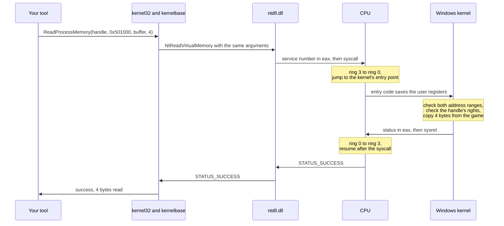
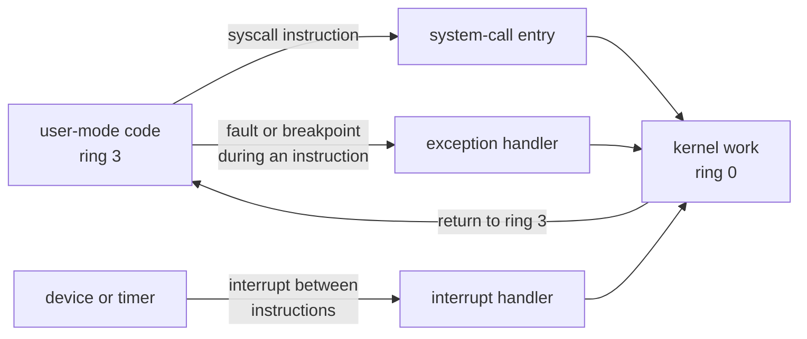

import { Frame } from '../../../../components/kit';
import MarginNote from '../../../../components/kit/MarginNote.astro';

The tools so far have asked Windows for something: a handle to a game, a
copy of four bytes, a list of loaded modules. Each time, something checked
whether the tool was allowed to ask, did the work, and sometimes said no. The
**kernel** is the core of the operating system that coordinates those requests
with the processor's highest operating-system privilege. Ordinary programs go
through its controlled services to reach shared resources such as another
process's memory, the disk, the display, or a network device.

This lesson answers four questions. How does the processor keep ordinary
programs away from the kernel's powers? How does a program ask the kernel for
something anyway? What does the kernel do with its authority? And why can one
kernel bug stop the whole computer, when a bug in a game only ends the game?
A four-byte `ReadProcessMemory` request will carry these questions through the
user/kernel boundary. The next two lessons open that request up:
[Lesson 12.5](/pages/10/07/) follows the Windows DLL layers it passes through
on the way down, and [Lesson 12.6](/pages/14/07/) reads the exact bits the
processor checks and follows the request one layer at a time.

## Two modes, enforced by the processor

The kernel and a game run on the same processor, often on the same core, taking
turns many times a second. What stops the game from doing what the kernel does:
rewriting another process's memory, reprogramming the disk controller, or
simply never giving the processor back?

A protection check in memory the restricted program can overwrite would not
stop it. The restriction has to be enforced beyond that writable memory. The
processor checks privilege and memory permissions before carrying out an access.

So the processor tracks a **privilege level** for the code it is running. It
checks privileged instructions and page translations against that level. x86
processors define four levels, numbered 0 to 3 and usually drawn as nested
**rings**, with ring 0 the most privileged. Windows uses two of them:

- **kernel mode**, ring 0, for the kernel and drivers;
- **user mode**, ring 3, for everything else: games, browsers, debuggers, and
  every tool in this book.

The processor records the current level in two bits of one of its registers,
which [Lesson 12.6](/pages/14/07/#the-current-level-is-two-bits-of-a-register)
reads in a debugger. What matters here is what the processor refuses to do
while the level is 3.

### What ring 3 is not allowed to do

At ring 3 the processor refuses two kinds of thing.

**Privileged instructions.** Some instructions only make sense for whoever runs
the machine. `hlt` stops the processor until the next interrupt. `cli` turns
interrupts off, which would silence the timer the kernel relies on to take the
processor back. `mov cr3, rax` switches to a different set of page tables,
which selects a process's whole view of memory. The physical-memory lessons
in Chapter 13 will follow those page tables. `wrmsr` rewrites the processor's internal
settings. At ring 3, each of these raises a **general-protection fault**
instead of running, and the kernel turns the fault into an exception that
normally ends the program.

**Memory marked for the kernel.** Page-table entries carry a
**user/supervisor** bit, bit 2. When it is 0 on a present mapping, a ring-3
access causes a page fault. Windows reserves a system range of virtual
addresses for the kernel. In a traditional shared page table, kernel pages can
be mapped there alongside a game's pages, but their supervisor bit still
blocks the game. With [KVA shadow](https://www.microsoft.com/en-us/msrc/blog/2018/03/kva-shadow-mitigating-meltdown-on-windows),
the user-mode page table omits most kernel mappings and keeps only the pages
needed to enter the kernel; entry code switches to the fuller kernel page
table. In either arrangement, a game cannot read or write the kernel's
privileged pages. [Lesson 11.11](/pages/14/07/#one-bit-marks-a-page-as-the-kernels)
compares the flag bits of a user page and a kernel page.

Put the two checks together and user-mode code is boxed in. It cannot run the
instructions that change privilege or page mappings, and it cannot alter
the kernel's page tables.

## A system call is how a program asks

If ring 3 cannot touch kernel memory or raise its own level, how does
`ReadProcessMemory` ever reach code that can read another process? Through a
**system call**: an instruction that switches the processor to ring 0 and jumps
to an address the kernel chose. On x86-64 the instruction is `syscall`. When
the processor executes it, it:

1. copies the address of the next instruction into `rcx` and the flags register
   into `r11`, so the kernel can come back later;
2. switches the privilege level to 0;
3. jumps to an address held in a processor setting that only ring 0 can change.
   The kernel wrote that address during boot, using `wrmsr`.

Step 3 is what makes the design safe. A program chooses *when* to request a
service, never an arbitrary kernel instruction to run. The processor enters a
kernel-controlled path, which identifies the requested service and checks its
untrusted arguments. This is the controlled crossing that the Windows API
lessons relied on, now seen from the processor's side.

<MarginNote kind="brief">A system call enters a kernel-chosen service path; it does not let the caller pick arbitrary privileged instructions to execute.</MarginNote>

## Follow one call into the kernel and back

Take a read like the ones in [Lesson 11.5](/pages/10/03/): a handle to the game
opened with only query and read rights, and a request for 4 bytes at address
`0x0050_1000`. Here is the whole round trip:

The call passes through `kernel32.dll` and `kernelbase.dll` to
`NtReadVirtualMemory` in `ntdll.dll`, which puts a **service number**, telling
the kernel which of its routines to run, into the `eax` register and executes
`syscall`. The kernel's own `NtReadVirtualMemory` then checks two things before
it touches anything:

- both address ranges, the 4 bytes in the game and your tool's buffer, must lie
  in user space, so `ReadProcessMemory` can never read kernel memory, whatever
  handle you hold;
- the handle must carry the right the operation needs. This one has
  `PROCESS_VM_READ`, so the read is allowed. It lacks `PROCESS_VM_WRITE`, so a
  write through it would be refused, and nothing can add that right later: a
  handle's rights are fixed when it is opened.

Only then does the kernel copy the 4 bytes into your buffer. It puts a status
code in `eax`, here `STATUS_SUCCESS`, which is 0, and executes `sysret`, the
reverse of `syscall`: the level drops back to 3 and your thread resumes after
its `syscall`. On a failure, `kernelbase.dll` turns the status into the error
number that `GetLastError` reports, such as 5 for access denied.
[Lesson 12.6](/pages/14/07/#the-same-call-one-layer-at-a-time) follows each
step with its values: the kernel's own stack, the saved registers, and the
arithmetic of the rights check.

## How the kernel regains control

A system call is one common way execution crosses from a user thread into the
kernel. Two others are **exceptions**, raised by the instruction that is running
(a page fault, a division by zero, the `int3` breakpoint), and **interrupts**,
signals that arrive between instructions whether or not the running program
expects them.

The kernel does not interpret each ordinary game instruction. These entries
bring a user thread into kernel code when work needs its authority. Windows
also schedules its own kernel worker threads for work that need not begin in a
game's call. Both facts fit the same model: the kernel is code with privileged
responsibilities, and the processor enforces who may run it.

The processor finds exception and interrupt handlers through the **interrupt
descriptor table**, which the kernel fills in at boot. Each entry is chosen by
a one-byte **vector** number. One byte holds 2⁸ = 256 values, so the table has
at most 256 entries, numbered 0 to 255. The processor fixes the meaning of
vectors 0 to 31: vector 3 is the breakpoint exception that the byte `0xCC`,
`int3`, raises ([Lesson 2.4](/pages/2/03/)), vector 13 is the general-protection
fault, and vector 14 is the page fault. Devices are given vectors from 32 up.

## What the kernel does with its authority

### It schedules threads

A computer has a handful of processor cores and, at any moment, hundreds or
thousands of threads ([Lesson 11.8](/pages/10/06/) described ready, running,
and waiting threads). The kernel's **scheduler** decides which ready thread
runs on each core. Timer interrupts are one opportunity to reconsider that
choice; a thread blocking for input or a lock is another. Timer resolution and
interrupt scheduling vary by Windows version, hardware, and power state, so a
fixed tick interval is not a reliable description of every game session.

When a running thread stops to wait for input, a lock, or a timer, or when its
turn is interrupted, the scheduler can pick another thread. Changing threads is a **context
switch**: the kernel saves the old thread's registers into its context, loads
the new thread's registers, and, if the new thread belongs to a different
process, loads that process's top-level page-table address into `cr3`. The
program never sees the switch. Its registers come back exactly as they were.

<MarginNote kind="alternative">A context switch changes the bookmark and working registers for an execution path; changing processes also selects that process’s memory map.</MarginNote>

<Frame caption="A context switch saves one thread’s registers, loads the next thread’s, and swaps page tables only across processes.">
  
</Frame>

### It manages every process's memory

Each process has its own page tables, and only the kernel writes them.
Reserving an address range and committing storage are distinct operations, as
Lesson 11.7 showed. Even after a page is committed, Windows may assign its
physical frame only on first access. That access faults, the kernel supplies a
zeroed page so old data cannot leak between processes, updates the mapping,
and retries the instruction. The game normally never sees this handled fault.
[Lesson 11.7](/pages/10/05/) looked at the result from outside, and
[Lesson 12.7](/pages/11/06/) will examine how physical memory fits beneath
that view.

<MarginNote kind="narration">A first-access page fault can be normal: the kernel supplies the page and retries the instruction. A fault does not always mean the game has crashed.</MarginNote>

### It handles interrupts

When a device needs attention, because a key was pressed, a disk transfer
finished, or a network packet arrived, it raises an interrupt. The processor
finishes its current instruction, saves where it was, enters ring 0 if it was
not there already, and runs the handler for that vector. The interrupted code,
kernel or user, resumes afterward as if nothing had happened. Handlers must be
short, because other work on that core waits while they run;
[Lesson 12.4](/pages/14/02/) shows how drivers split the work.

### It owns devices through drivers

Ordinary user programs reach devices through operating-system interfaces
rather than writing device registers directly. A **driver** knows a device's
register layout and command protocol, and Windows routes requests through the relevant driver
stack. Lesson 12.4 follows one request down to the hardware.

### It enforces security checks

The processor enforces privileged-instruction and page-permission checks in
hardware. Windows checks handle rights and validates request ranges in the
kernel, where the caller cannot simply skip the decision. The kernel also
enforces the access tokens and integrity levels from Lesson 11.5, the page
protections from Lesson 11.7, and the signing rules that decide which drivers
may load at all (Lesson 12.4).

## Recognize the subsystem in a kernel routine's name

Driver documentation and debugger stacks often use short prefixes as clues
to a routine's subsystem. The table connects those names to the responsibilities
above; the linked routines are reading examples, not extra lab steps.

| Prefix | Conceptual meaning | Representative documented routine |
| --- | --- | --- |
| `Cm` | Configuration manager: registry operations | [`CmRegisterCallbackEx`](https://learn.microsoft.com/en-us/windows-hardware/drivers/ddi/wdm/nf-wdm-cmregistercallbackex) registers a registry callback. |
| `Ex` | Executive support: shared kernel helpers | [`ExAllocatePool2`](https://learn.microsoft.com/en-us/windows-hardware/drivers/ddi/wdm/nf-wdm-exallocatepool2) allocates kernel pool memory. |
| `Hal` | Hardware abstraction layer: platform hardware details | [`HalGetAdapter`](https://learn.microsoft.com/en-us/windows-hardware/drivers/ddi/_kernel/) is an obsolete DMA-adapter example; use `IoGetDmaAdapter` instead. |
| `Io` | I/O manager: devices and I/O requests | [`IoCreateDevice`](https://learn.microsoft.com/en-us/windows-hardware/drivers/ddi/wdm/nf-wdm-iocreatedevice) creates a driver device object. |
| `Ke` | Kernel: scheduling, synchronization, interrupt priority | [`KeGetCurrentIrql`](https://learn.microsoft.com/en-us/windows-hardware/drivers/ddi/wdm/nf-wdm-kegetcurrentirql) reports the current interrupt request level. |
| `Mm` | Memory manager: virtual and physical memory | [`MmProbeAndLockPages`](https://learn.microsoft.com/en-us/windows-hardware/drivers/ddi/wdm/nf-wdm-mmprobeandlockpages) probes and locks buffer pages. |
| `Ob` | Object manager: object references and handles | [`ObReferenceObjectByHandle`](https://learn.microsoft.com/en-us/windows-hardware/drivers/ddi/wdm/nf-wdm-obreferenceobjectbyhandle) checks a handle and references its object. |
| `Po` | Power manager: device power transitions | [`PoRequestPowerIrp`](https://learn.microsoft.com/en-us/windows-hardware/drivers/ddi/wdm/nf-wdm-porequestpowerirp) requests a device power operation. |
| `Tm` | Kernel Transaction Manager: coordinated transactions | [`TmCommitTransaction`](https://learn.microsoft.com/en-us/windows-hardware/drivers/ddi/wdm/nf-wdm-tmcommittransaction) initiates a transaction commit. |
| `Nt` | Native system services | [`NtCreateFile`](https://learn.microsoft.com/en-us/windows/win32/api/winternl/nf-winternl-ntcreatefile) is a native file-service entry. |
| `Zw` | The paired native-service naming convention | [`ZwCreateFile`](https://learn.microsoft.com/en-us/windows-hardware/drivers/ddi/wdm/nf-wdm-zwcreatefile) reaches the corresponding file service. |

<MarginNote kind="brief">A prefix identifies a family of routines; it grants no privilege. The processor's mode, the API's requirements, and the request's permissions still determine what a caller can do.</MarginNote>

`Nt` and `Zw` need one extra distinction. For system calls from **user mode**,
their versions behave alike and treat arguments as untrusted user input. From
**kernel mode**, `Zw` treats parameters as coming from a trusted kernel source;
`Nt` uses the calling thread's previous mode to decide how to interpret and
validate them. This is a calling-context rule, not a way for a user program
to gain ring 0. Microsoft's [Nt/Zw explanation](https://learn.microsoft.com/en-us/windows-hardware/drivers/kernel/using-nt-and-zw-versions-of-the-native-system-services-routines)
describes the distinction.

Older examples need a version check. [`ExAllocatePool`](https://learn.microsoft.com/en-us/windows-hardware/drivers/ddi/wdm/nf-wdm-exallocatepool)
is deprecated; Microsoft's [migration guide](https://learn.microsoft.com/en-us/windows-hardware/drivers/kernel/updating-deprecated-exallocatepool-calls)
replaces it with `ExAllocatePool2` for drivers targeting Windows 10 version 2004
or later. `HalGetAdapter` remains listed for existing drivers, but the documented
replacement is [`IoGetDmaAdapter`](https://learn.microsoft.com/en-us/windows-hardware/drivers/ddi/wdm/nf-wdm-iogetdmaadapter).
An old name in a stack can explain the subsystem without being a good choice
for new code.

## Why a kernel bug takes the whole machine down

When user-mode code follows a bad pointer, the processor raises a page fault,
the kernel finds that nothing valid lives at that address, and it turns the
fault into an access-violation exception for that one process. In the worst
case one process ends; the kernel is the safety net under every user-mode
program.

Nothing sits beneath the kernel in the same way. Kernel code and drivers share
one address space and one set of data structures, so when a driver follows a
bad pointer by mistake, the unexpected fault may strike halfway through an
update to one of those structures, with a lock still held. Windows cannot prove
which of its records are still sound, so it stops the whole machine on purpose. That stop is a **bug check**,
better known as the blue screen: Windows shows a stop code, writes a crash
dump if it can, and restarts.
[Lesson 12.9](/pages/11/05/#why-a-kernel-bug-takes-the-whole-machine-down)
follows that decision step by step, beside the other risks of trusted kernel
code. It is also why the book keeps its labs in user mode and inside a virtual
machine: a crash in a user-mode lab ends one process, and even a bug check
inside a virtual machine stops only that virtual machine.

## Why some anti-cheat runs a kernel component

Anti-cheat software exists to notice when another program interferes with a
game. A kernel component lets it use Windows facilities that user-mode code
cannot reach. One of them is a **handle-operation callback**, which runs while
another process opens a handle to the game and may remove rights from the
request. A tool that asks for read and write rights can receive a handle
without them, and its `ReadProcessMemory` then fails at exactly the rights
check described above.

The cost is that such code has the same authority as the rest of the kernel.
Its bugs become bug checks on players' machines, and a vulnerability in it
becomes a vulnerability in every machine it is installed on.
[Lesson 15.3](/pages/15/04/#why-some-anti-cheat-runs-a-kernel-component)
weighs what that extra visibility buys against those costs. First, the next
lessons in this chapter show what driver code actually does and why its
interface must be narrow.

References: [User mode and kernel mode](https://learn.microsoft.com/en-us/windows-hardware/drivers/gettingstarted/user-mode-and-kernel-mode), [process security and access rights](https://learn.microsoft.com/en-us/windows/win32/procthread/process-security-and-access-rights), [bug check code reference](https://learn.microsoft.com/en-us/windows-hardware/drivers/debugger/bug-check-code-reference2), and [`ObRegisterCallbacks`](https://learn.microsoft.com/en-us/windows-hardware/drivers/ddi/wdm/nf-wdm-obregistercallbacks).
