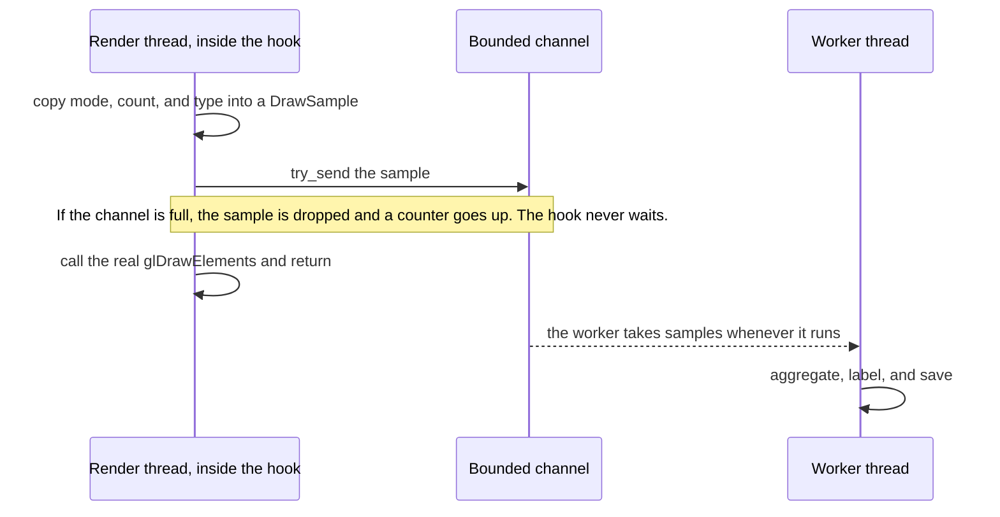

import CodeTrace from '../../../../components/CodeTrace.astro';
import { Frame, GitHub, Panel } from '../../../../components/kit';

import MemoryStrip from '../../../../components/MemoryStrip.astro';
import MarginNote from '../../../../components/kit/MarginNote.astro';

## A wrapper records and forwards draw calls

Lesson 7.2 showed that a draw submission combines geometry with the graphics
state already in effect. To learn which submissions correlate with an entity,
we need to observe calls without changing the frame they produce. OpenGL
applications call functions such as `glDrawElements`. First consider a
whole-call wrapper: it sits between the caller and the real function:

```text
game calls glDrawElements
→ wrapper copies a small sample of the arguments
→ wrapper calls the real glDrawElements
→ frame continues
```

If the game makes a draw with `count = 9`, the wrapper records that value and
then passes the same arguments to OpenGL. The picture should remain identical;
only the separate observation log changes. The wrapper must preserve the
exact ABI and forward every normal call.
The pinned Urban Terror implementation in
[Lesson 8.8](/pages/8/08/#turn-the-wrapper-into-the-actual-urban-terror-wallhack)
instead detours an instruction **inside** `glDrawElements`, so it has a
narrower restoration opportunity. Keep that difference visible when comparing the two designs.


<CodeTrace trace="handoff-draw-forward" />

## What an indexed draw actually requests

`glDrawElements(mode, count, element_type, indices)` asks OpenGL to consume an
ordered sequence of vertex indices:

| Argument | Meaning |
|---|---|
| `mode` | how index results form primitives, such as triangles or lines |
| `count` | number of indices to read |
| `element_type` | width/format of each index, such as 16- or 32-bit unsigned |
| `indices` | byte offset into a bound index buffer, or an address in old client-memory mode |

The call does not directly identify a model. OpenGL combines those indices with
the currently bound vertex attributes, textures, transforms, and other state. One
character may require several draws—body, head, weapon, shadow—and one draw may
contain many instances or a batch of unrelated objects.

<MarginNote kind="brief">A draw request identifies submitted geometry and bound state, not one complete game object.</MarginNote>

With `GL_TRIANGLES`, every complete group of three indices describes one submitted
triangle. The indices may repeat vertices, and some triangles may be degenerate,
clipped, back-face culled, or hidden by depth. Therefore:

```text
count / 3 = maximum submitted triangle groups
count / 3 ≠ visible triangle count
count     ≠ unique vertex count
```

For example, this index buffer holds nine indices, so a call with `count = 9`
submits 9 ÷ 3 = 3 triangles:

<MemoryStrip
  cells="0=0|1=1|2=2|3=2|4=1|5=3|6=2|7=3|8=4"
  groups="0-2:triangle 0|3-5:triangle 1|6-8:triangle 2"
  groups2="0-8:nine indices, but only five different vertices: 0, 1, 2, 3, 4"
  caption="Each box holds one index, and the label above it is its position in the buffer. Triangles 0 and 1 share the edge from vertex 1 to vertex 2, and triangles 1 and 2 share the edge from vertex 2 to vertex 3, so `count` (9) is not the number of vertices (5)."
/>

The `indices` parameter is especially easy to misread. If an element-array buffer
is bound, a small value such as `0x120` is an offset into GPU-managed buffer state,
not a process pointer that should be dereferenced.

## CPU submission and GPU execution overlap

The CPU usually records commands faster than the GPU completes them. A draw call
returning does not mean its pixels are finished. Reads that force the GPU to catch
up can stall both processors. The hook sees *submitted work*: it runs when the
CPU queues a draw, not when the GPU finishes its pixels.

```text
CPU frame N+1: build and submit commands ──────────────►
GPU frame N:       execute vertices → rasterize → shade ─────────►
```

This overlap explains why a debugger pause or synchronous query can create a much
larger performance change than its own instruction count suggests.

## A hook sits on the program's critical path

The render thread has a deadline: finish enough work for the next frame. A hook adds work to a path that may execute thousands of times per second. Even memory-safe code can cause stutter if it allocates, waits for a lock, formats strings, or writes files there.

<MarginNote kind="narration">A tiny delay repeated for thousands of draws can consume the frame budget. Move formatting and disk writes away from the render thread.</MarginNote>

Split the design into two rates:

- the **capture path** copies a tiny fixed-size sample and returns immediately;
- the **analysis path** runs later on a worker and may aggregate, label, or save bounded results.



The render thread's work ends at `try_send`; everything slow happens on the
worker's schedule. Measure both dropped samples and time spent in the hook. A
dropped sample leaves a gap in the log, while blocking slows the very frames you
are trying to measure.

<Frame caption="Locating glDrawElements in the debugger.">


</Frame>

## Write the function type

For a 32-bit Windows OpenGL 1.x target, the calling convention is significant:

```rust
use std::ffi::c_void;

type GlDrawElements = unsafe extern "system" fn(
    mode: u32,
    count: i32,
    element_type: u32,
    indices: *const c_void,
);
```

The exact signature comes from the OpenGL API, not from guessing registers.

In an older fixed-function renderer, transforms and arrays may be ordinary OpenGL
state. In a modern renderer, shader programs and buffer objects carry the same
roles. Hooking the draw call still works, but the state needed to explain a draw
changes with the API version and engine.

## Keep the original function

The wrapper needs a way to reach the real OpenGL function after it has
intercepted a call. Store the resolved function pointer once during setup;
every draw can then forward through that saved pointer without another
lookup on the render thread:

<MarginNote kind="alternative">A forwarding wrapper is a receptionist with the original extension saved: recording the request must not route it back through the receptionist indefinitely.</MarginNote>

```rust
use std::sync::OnceLock;

static ORIGINAL_DRAW_ELEMENTS: OnceLock<GlDrawElements> = OnceLock::new();
```

Initialization must resolve and store the real function before the wrapper can forward calls. Avoid resolving it recursively through your own wrapper.

The failure is **recursion**: a function calls itself. Recursion is useful when
each call handles a smaller case and a **base case** eventually returns. Here
there is no smaller case. If `ORIGINAL_DRAW_ELEMENTS` accidentally points to
`draw_elements_hook`, the call path is:

```text
game → draw_elements_hook → stored "original" → draw_elements_hook → ...
```

No call reaches OpenGL, so no call can return. Each nested call keeps a
**stack frame** for its return address and local values, as
[Lesson 3.4](/pages/3/03/#the-calls-frame-and-the-objects-lifetime) explained.
The thread's finite stack (often 1 MiB by default for a Windows executable,
but configurable) eventually fills and Windows raises a stack-overflow
exception, usually on the first draw. Resolving the real function before
installing the wrapper breaks this cycle. The failure table at the end of the
lesson calls this "Infinite recursion."

## Forward first

Begin with a transparent wrapper:

```rust
unsafe extern "system" fn draw_elements_hook(
    mode: u32,
    count: i32,
    element_type: u32,
    indices: *const c_void,
) {
    let original = ORIGINAL_DRAW_ELEMENTS
        .get()
        .expect("OpenGL wrapper was not initialized");

    // 🔁 SAFETY: the wrapper preserves the API signature and forwards the exact
    // arguments supplied by the original caller.
    unsafe { original(mode, count, element_type, indices) };
}
```

Run the game and verify that rendering is unchanged. Only then add the code that copies samples.

## Do not log every call to disk

Draw calls can occur thousands of times per frame. Synchronous file output inside the hook will destroy performance and can cause re-entry problems.

Use a bounded channel and allow drops:

```rust
#[derive(Clone, Copy, Debug)]
struct DrawSample {
    mode: u32,
    count: i32,
    element_type: u32,
}

// 🎯 In the hook, observe the state immediately before forwarding the call:
let _ = sender.try_send(DrawSample { mode, count, element_type });
```

A worker thread can aggregate samples later. If the channel is full, losing a sample is better than blocking the render thread.

## Classify with experiments

The `count` argument may correlate with a model in one exact build:

<Frame caption="Filtering draw calls by their count argument.">


</Frame>

But `count` alone is fragile. Different objects can share a vertex count, and model updates can change it.

Collect features such as:

- draw mode;
- element count;
- bound texture;
- shader or fixed-function state;
- model/view transform;
- call site.

Then change one visible object and compare the samples.

Capture the smallest feature vector that can answer the current question:

```rust
#[derive(Clone, Copy, Debug)]
struct DrawFingerprint {
    call_site: usize,
    mode: u32,
    index_count: i32,
    index_type: u32,
    texture: u32,
    frame_number: u64,
}
```

`call_site` distinguishes engine submission paths, but compiler inlining and
updates can change it. `texture` can identify a material in one scene, but skins,
quality settings, and atlases can change it. A feature can be trusted to
identify a category only after changing one thing at a time — the model, the
map, a graphics setting — leaves it pointing at the same objects.

This is a classification problem. A threshold such as `count > 500` separates the examples you observed, not necessarily the concept “player.” Test it against weapons, detailed scenery, menus, different models, and different graphics settings. Report false positives (something your classifier caught that is not a player) and false negatives (a player your classifier missed) instead of quietly turning a correlation into a definition.

## Shaders turn vertex records into pixels

A **shader** is a small GPU program invoked many times in parallel. The vertex
shader and fragment shader of
[Lesson 7.2's pipeline](/pages/5/02/#follow-state-through-the-rendering-pipeline)
are the two central here: the first turns one vertex into a clip-space position
plus values to interpolate, and the second turns one covered sample into a
color, depth, or other output.

Values such as texture coordinates and normals are interpolated across a triangle.
The fragment shader usually does not receive the original vertex value. This is why
a draw's texture, program, uniforms, and vertex layout are part of its identity.

Older fixed-function OpenGL calls hide these programs behind predefined state, but
the pipeline still performs equivalent transformations and color calculations.

### What a shader reads

A shader works only with what the draw has bound for it:

- **Interpolated inputs**, the per-vertex values blended across the triangle.
- **Uniforms**, values that are the same for every invocation of one draw, such as the
  matrices, a light's colour, or the time since the game started.
- **Textures and buffers**, images it can sample at a `(u, v)` position and arrays of
  data it can read, bound before the draw as part of the state from Lesson 7.2.

A small fragment shader that turns a texture grey shows how little a shader can be. It
weights the red, green, and blue of the pixel by how bright the eye finds each:

```glsl
// Fragment shader, in GLSL: turn the texture's colour into grey.
vec3 colour = texture(image, uv).rgb;
float grey = dot(colour, vec3(0.299, 0.587, 0.114));
out_colour = vec4(vec3(grey), 1.0);
```

For a pixel of `(200, 100, 50)`, the grey is 0.299 × 200 + 0.587 × 100 + 0.114 × 50 =
59.8 + 58.7 + 5.7 = 124.2, so the pixel becomes about `(124, 124, 124)`. A shader that
reads the time as a uniform can animate: a brightness of `0.5 + 0.5 × sin(time)` is
0.5 at time 0 and 1.0 at time 1.5708 (a quarter of a turn in radians), and it
repeats.

Shaders are written in a shading language: GLSL for OpenGL, HLSL for Direct3D, WGSL
for WebGPU. A driver, or the engine ahead of time, compiles them to the GPU's own
instructions. Engines that support several graphics APIs often write a shader once and
translate it for each.

<span id="variants-instancing-and-shaders-that-do-not-draw" aria-hidden="true" />
<span id="why-many-small-draws-cost-frame-time" aria-hidden="true" />

Each on/off switch in a shader's source doubles the programs that can be
compiled, so three switches give 2 × 2 × 2 = 8 **variants**. **Instancing** draws
many copies of one mesh in one call, with a 4 × 4 matrix of 16 four-byte floats,
64 bytes, per copy. A **compute shader** does not draw at all: it reads and writes
buffers for work such as particles. And every draw costs CPU time even when the
GPU's share is tiny: at 5 microseconds each, 10,000 draws take 50 ms, three
16.67 ms frames. If halving the window's pixel count leaves the frame time
unchanged, the CPU is the limit.
[Lesson 7.11](/pages/5/11/#variants-instancing-and-shaders-that-do-not-draw)
works through these beside the bound state that each Direct3D draw carries.

<span id="turn-the-wrapper-into-the-actual-urban-terror-wallhack" aria-hidden="true" />

## Restore graphics state

OpenGL is a state machine: a call changes settings that remain active until
another call changes them. Two depth settings show how much a later draw
inherits:

`glDepthRange(near, far)` controls where a fragment's depth lands in the
depth buffer after projection, by remapping the normalized `-1..1` range onto
whatever window-space interval you pass in. The default call is
`glDepthRange(0.0, 1.0)`: keep every fragment's real depth. Calling
`glDepthRange(0.0, 0.0)` instead collapses that mapping to a single point —
every fragment's stored depth becomes `0.0`, the value reserved for the
nearest possible surface, no matter how far away the vertex actually was.
`GL_LEQUAL` passes a fragment whose depth is less than or equal to the stored
depth, and no stored depth is below `0.0`, so a collapsed fragment passes that
test. A strict test such as `GL_LESS` would reject it wherever `0.0` is already
stored, for example from an earlier collapsed draw. Switching `glDepthFunc` to
`GL_ALWAYS` removes the comparison altogether: the test passes unconditionally,
whatever is already in the buffer. The wrapper makes both calls, flattening the
depth and then skipping the test, so highlighted geometry is drawn through walls
however the game left its depth function.

The exact-build Urban Terror 4.3.4 wallhack applies that combination to
player-sized draws from a cave inside `glDrawElements`. The cave saves the flags
and every general-purpose register before calling its helper, because the
interrupted OpenGL function expects them unchanged; it fills the sixth replaced
byte with a `nop` so no fragment of the old instruction remains; it restores
normal depth state on the next non-highlighted draw; and it is switched off
before its code patch is removed, so `GL_ALWAYS` is never left active. It is in
[Lesson 8.8](/pages/8/08/#turn-the-wrapper-into-the-actual-urban-terror-wallhack),
after the DLL loading and detour lessons that its installation depends on.

State restoration must match what was changed. A robust typed wrapper queries or
tracks the previous depth function, depth range, enabled client arrays, color, and
bindings. Restoring guessed “defaults” works only until another legitimate render
pass enters with different state. A middle-of-function cave, like that one, has fewer safe options,
which is a real limitation of that interception point rather than an implementation
detail to ignore.

## Diagnose common failures

<Panel title="Common draw-call failures">

| Result | Check |
|---|---|
| Immediate crash | Signature, calling convention, or original pointer |
| Infinite recursion | Original resolved to wrapper |
| Missing geometry | Parameters were not forwarded exactly |
| Broken later draws | Graphics state not restored |
| Huge slowdown | Blocking or allocation inside the hook |

</Panel>

The first success is not a visual effect. It is a transparent wrapper that produces a bounded stream of samples while the game draws normally.
