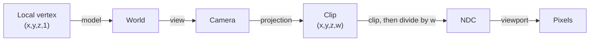

import { Accordion, Example, Frame, GitHub, Panel, Steps, Tooltip } from '../../../../components/kit';
import LessonVideo from '../../../../components/LessonVideo.astro';

import PerspectivePlayground from '../../../../components/PerspectivePlayground.astro';
import Scene from '../../../../components/Scene.astro';
import MarginNote from '../../../../components/kit/MarginNote.astro';

## World-to-screen uses the view-projection transform

An ESP-style observer needs to answer:

> Where would this 3D point appear on the 2D screen?

The reliable answer uses the game’s view-projection matrix. Hand-tuned angle formulas can teach geometry, but a matrix handles camera rotation, field of view, aspect ratio, and perspective together.

<Frame caption="A simple viewport diagram.">


</Frame>

The matrix is not magic screen-coordinate data. It is a compact composition of
specific coordinate changes. If its convention, snapshot time, or viewport does
not match the rendered frame, the resulting pixels can be precise arithmetic and
still describe the wrong image.

## Name every coordinate space

“World to screen” is not one mysterious jump. It is a pipeline of smaller
changes, and every stage answers a different question:

```text
world space
  where the entity exists in the game world
      ↓ view transform
camera space
  where the entity is relative to the camera
      ↓ projection transform
clip space (x, y, z, w)
  a perspective-aware position before division
      ↓ divide x, y, and z by w
normalized device coordinates
  a small standard cube used for clipping
      ↓ viewport transform
screen pixels
  where the overlay may draw
```



This tour chooses a world point `(2, 1, -4)` and a camera at `(1, 0, 0)`
looking along negative Z. Its right and up directions match the world axes.
Subtracting the camera position gives `(1, 1, -4)`. Choose an 800-by-800
viewport so the aspect ratio is one. A 90-degree vertical field of view
gives `1 / tan(45°) = 1`. Choose near and far distances of one and nine;
the depth formula below then gives `(9 + 1) / (1 - 9) = -1.25` and
`2 × 9 × 1 / (1 - 9) = -2.25`. These settings make every conversion visible.

<Scene name="world-to-screen" />

Naming the stages makes bugs easier to locate. A marker that rotates the wrong
way usually points to the view transform. A marker that stretches after a
resolution change points to the viewport or aspect ratio. A point behind the
camera that appears mirrored points to the perspective divide or clipping.

The `w` value is not another world direction;
[Why perspective uses `w`](#why-perspective-uses-w) shows how it carries depth.
Reject unusable `w` values before dividing, then reject points outside the
target API's depth interval. OpenGL commonly uses `-1..=1` after projection;
Direct3D commonly uses `0..=1`. The matrix and convention must come from the
same game pipeline.

## The view matrix is the inverse camera pose

A camera pose says where the camera exists in world space. Rendering needs the
opposite question: where does the world appear relative to the camera? Therefore
the view matrix is the inverse of the camera's world transform.

<MarginNote kind="alternative">The camera pose moves the camera through the world; the view matrix asks how the world looks from that moved camera, so it reverses the pose.</MarginNote>

For an orthonormal camera basis, inverse rotation is its transpose. The translation
is not simply `-camera_position`; it is the negative position expressed along the
camera basis. In dot-product form, that is the view transform from
[Lesson 7.1](/pages/5/01/#a-basis-defines-the-local-axes): subtract the camera
position, then take the dot product of the result with each camera axis.

If positions track correctly until the camera rotates, the translation may be
right while the basis order, handedness, or inverse operation is wrong.

## Why perspective uses `w`

Far-away objects look smaller. After the matrix transformation, perspective division divides the transformed `x`, `y`, and `z` by `w`:

<MarginNote kind="brief">Perspective division makes the same world-sized object occupy fewer screen pixels as its depth increases.</MarginNote>

```text
ndc_x = clip_x / clip_w
ndc_y = clip_y / clip_w
```

This creates perspective because the projection matrix is built so that the
resulting `w` carries the point's distance from the camera: dividing by `w`
divides by depth. Ignoring signs and API details, for a symmetric perspective
camera:

```text
screen_x ∝ view_x / view_depth
screen_y ∝ view_y / view_depth
```

Double the depth while keeping the sideways offset unchanged and the point moves
half as far from the screen center, so an object twice as far away covers half
as much screen. A perspective matrix stores this division in `w` so the GPU can
delay it until after clipping.

If `w` is zero, the division is undefined. In the convention used in this
lesson, where a point in front of the camera has a positive `w`, a negative `w`
puts the point behind the camera — and the division still yields a perfectly
ordinary-looking coordinate, with both signs flipped. This is the classic
overlay bug: an enemy standing directly behind the player gets drawn on screen
in front, mirrored to the opposite side, with the box sliding the wrong way as
they move. Nothing crashes and no number looks obviously wrong, so
world-to-screen code must skip any point whose `w` is at or below a small
positive threshold before producing pixels, as the `clip_w` test in
[Transform a point](#transform-a-point) does.

## What field of view and aspect ratio change

The vertical field of view `fov_y` determines how much of the world fits from top
to bottom. The aspect ratio is `width / height`. A common perspective scale is:

```text
y_scale = 1 / tan(fov_y / 2)
x_scale = y_scale / aspect
```

Here is where that comes from. Picture the frustum at some depth `d` straight
ahead of the camera. Half the vertical field of view is the angle from the
center line up to the top edge of what the camera sees, so — for a right
triangle with that angle and an adjacent side of length `d` — the frustum's
half-height at that depth is `d × tan(fov_y / 2)`. A point sitting exactly on
that top edge has `view_y = d × tan(fov_y / 2)`, and it needs to land at the
very top of the screen, NDC `y = 1`. Since `screen_y` is proportional to
`view_y / view_depth`, the scale factor that sends `tan(fov_y / 2)` to `1` is
its reciprocal: `y_scale = 1 / tan(fov_y / 2)`.

Concrete numbers make the zoom effect visible. At `fov_y = 90°`, half the angle
is `45°` and `tan(45°) = 1`, so `y_scale = 1`. Narrow the field of view to
`60°`: half the angle is `30°`, `tan(30°) ≈ 0.577`, and `y_scale ≈ 1.732` — a
bigger multiplier, so the same `view_y / view_depth` now produces a larger NDC
value and the scene looks zoomed in. A smaller field of view makes
`tan(fov_y / 2)` smaller, so the scale grows and the view zooms in.

One practical trap sits in that formula. Trigonometric functions take
<Tooltip tip="A radian measures an angle by the arc it covers on a circle of radius 1. A full turn is 2π = 6.2832 radians, so a quarter turn, 90°, is 6.2832 ÷ 4 = 1.5708 radians.">radians</Tooltip>,
not degrees. Passing `90.0` where `1.5708` was expected produces a scale that
is wrong by a wide margin, and the symptom is a scene that looks nothing like a
camera view rather than an obviously wrong number. Convert at the boundary and
put the unit in the variable name.

`x_scale` reuses that number instead of deriving a separate one. At the same
depth `d`, the frustum's half-width must be `aspect` times its half-height,
because `aspect` is defined as `width / height`. Dividing `y_scale` by `aspect`
shrinks the horizontal scale by exactly that factor, so the wider half-width
still maps to NDC `x = 1`. Skip that division and a widescreen monitor
squashes the image horizontally instead of showing more of the scene.

## One concrete perspective matrix

Conventions must be attached to formulas. Under these assumptions:

- column vectors;
- right-handed camera space looking down `-Z`;
- vertical field of view `fov_y`;
- aspect ratio `width / height`;
- OpenGL NDC depth `-1..1`;
- positive near and far distances with `0 < near < far`;

define `f = 1 / tan(fov_y / 2)`, the `y_scale` from the previous section, so the
matrix's first entry, `f/aspect`, is `x_scale`. One projection matrix is:

```text
[ f/aspect   0             0                    0          ]
[    0       f             0                    0          ]
[    0       0     (far+near)/(near-far)  2far·near/(near-far) ]
[    0       0            -1                    0          ]
```

Multiplying a view-space point gives `clip_w = -view_z`, so points in front have
positive `w`. This exact matrix is not portable to a left-handed or Direct3D depth
convention. Its purpose is to show where assumptions live.

## Clipping happens before perspective division

In homogeneous clip space, the standard OpenGL visible volume satisfies:

```text
-w ≤ x ≤ w
-w ≤ y ≤ w
-w ≤ z ≤ w
```

For a Direct3D-style depth range, z is commonly constrained by `0 ≤ z ≤ w` while x
and y use the same bounds. A triangle crossing a plane is clipped into a smaller
polygon; it is not discarded merely because one vertex is outside.

Point labels are simpler: if their single anchor lies outside, reject or clamp the
label according to the chosen off-screen-label behavior. Do not use a point-label boundary check to reason
about whether an entire triangle should render.

The playground below uses one declared convention so every sign and axis has a
meaning. It deliberately treats forward as positive `+Z`, unlike the `-Z`
projection example above; this makes the depth control read naturally and shows
why formulas cannot be separated from their coordinate convention. Move the
point sideways, vertically, and through depth; then change
the vertical field of view. Watch how camera-space coordinates become NDC and
finally pixels.

<PerspectivePlayground />

## Represent the matrix

The projection routine needs three separate pieces of data: sixteen matrix
values, a screen position for successful projections, and the renderer's
accepted depth range. Naming them here keeps a Direct3D depth convention
from accidentally being applied to an OpenGL matrix:

```rust
#[derive(Clone, Copy, Debug)]
struct Mat4 {
    values: [[f32; 4]; 4],
}

#[derive(Clone, Copy, Debug)]
struct ScreenPoint {
    x: f32,
    y: f32,
    depth: f32,
}

#[derive(Clone, Copy, Debug)]
enum DepthConvention {
    OpenGl,
    Direct3D,
}

impl DepthConvention {
    fn contains(self, z: f32) -> bool {
        match self {
            Self::OpenGl => (-1.0..=1.0).contains(&z),
            Self::Direct3D => (0.0..=1.0).contains(&z),
        }
    }
}
```

First determine whether the target stores matrices row-major or column-major. Test with a known point while the camera is stationary.

There are three independent questions:

1. are consecutive values a row or a column (**storage layout**)?
2. does the math use row or column vectors (**multiplication convention**)?
3. is the candidate already `view × projection`, `projection × view`, or one
   component only (**composition**)?

A wrong answer to the first and a wrong answer to the second can cancel, and
neither the identity matrix nor a still camera reveals it. Validate identity,
translation, and a known 90-degree rotation together rather than repeatedly
transposing until one screenshot looks plausible.

<Accordion title="Optional reference: how two layout mistakes cancel">

Those three interact in a way that actively hides mistakes. Transposing a
matrix swaps its rows and columns, and switching between row-vector and
column-vector multiplication has precisely the same effect on the arithmetic.
Two wrong answers therefore cancel, and the transform appears to work — for
the wrong reasons:

```text
storage layout read wrong        -> effectively transposes the matrix
multiplication convention wrong  -> transposes it straight back
on screen                        -> correct, and still wrong
```

What makes this hard to catch is that the easiest test cannot detect it. The
identity matrix is symmetric, so transposing it changes nothing and it passes
under every combination of the three choices. A camera sitting still is nearly
as forgiving. A translation matrix and a 90-degree rotation matrix are not
symmetric, so under a cancelled pair of mistakes they are the first things to
break.

</Accordion>

## Transform a point

One row-major form looks like:

```rust
fn world_to_screen(
    point: Vec3,
    matrix: Mat4,
    width: f32,
    height: f32,
    depth_convention: DepthConvention,
) -> Option<ScreenPoint> {
    if !valid_point(point) || width <= 0.0 || height <= 0.0 {
        return None;
    }

    let m = matrix.values;
    let clip_x = point.x * m[0][0] + point.y * m[0][1]
        + point.z * m[0][2] + m[0][3];
    let clip_y = point.x * m[1][0] + point.y * m[1][1]
        + point.z * m[1][2] + m[1][3];
    let clip_z = point.x * m[2][0] + point.y * m[2][1]
        + point.z * m[2][2] + m[2][3];
    let clip_w = point.x * m[3][0] + point.y * m[3][1]
        + point.z * m[3][2] + m[3][3];

    if !clip_w.is_finite() || clip_w <= 0.001 {
        return None; // behind the camera or too close to project
    }

    let ndc_x = clip_x / clip_w;
    let ndc_y = clip_y / clip_w;
    let ndc_z = clip_z / clip_w;

    if !ndc_x.is_finite() || !ndc_y.is_finite() || !ndc_z.is_finite() {
        return None;
    }

    if !depth_convention.contains(ndc_z) {
        return None; // closer than the near plane or beyond the far plane
    }

    Some(ScreenPoint {
        // 🗺️ Convert normalized coordinates from -1..1 into screen pixels.
        // `midpoint` expresses the halfway step without overflowing the sum.
        x: ndc_x.midpoint(1.0) * width,
        y: (-ndc_y).midpoint(1.0) * height,
        depth: ndc_z,
    })
}
```

The positive-`w` front-facing test belongs to the projection convention described above. Some
pipelines use a different sign. Determine the front-facing half-space with a point
known to be directly ahead. The small epsilon avoids enormous coordinates near the
camera plane, but it is a policy threshold in clip-space units, not a universal
constant.

The midpoint calls implement:

```text
screen_x = viewport_x + (ndc_x + 1) × viewport_width / 2
screen_y = viewport_y + (1 - ndc_y) × viewport_height / 2
```

The y flip assumes an upper-left pixel origin. OpenGL's traditional viewport origin
is lower-left, and UI/window systems commonly use upper-left. Confirm which layer
the overlay draws into.

## Several cameras, one world

A camera is an object with a position and a turn like any other, plus a projection
and a few settings: which surface it draws into (the window, or an off-screen image),
which rectangle of that surface (its **viewport**), and when it draws compared with
the other cameras (its **order**). A split screen, a minimap, a rear-view mirror, and
a security monitor inside the game each use another camera. A camera that draws into
an off-screen image makes a texture that a material can then show on a mirror or a
monitor. Every formula in this lesson works for each camera separately, using that camera's viewport rather than the whole window.

<Example title="A 1920 × 1080 window with two players and a minimap">

| Camera | Viewport (x, y, width, height) | Aspect | Centre of its picture |
|---|---|---|---|
| player 1 | (0, 0, 960, 1080) | 960 ÷ 1080 = 0.889 | (480, 540) |
| player 2 | (960, 0, 960, 1080) | 960 ÷ 1080 = 0.889 | (960 + 480, 540) = (1440, 540) |
| minimap | (1664, 0, 256, 256) | 256 ÷ 256 = 1 | (1664 + 128, 128) = (1792, 128) |

The window's own aspect is 1920 ÷ 1080 = 1.778. Give player 1's camera that value
instead of 0.889, and its horizontal scale, `y_scale ÷ aspect`, comes out
0.889 ÷ 1.778 = 0.5 times what it should be, so the picture is squeezed to half its
width. And a world point that projects to the middle of player 2's picture belongs at
pixel x = 1440, not at 480.

</Example>

The minimap's viewport lies inside player 2's, so the minimap must draw later. The
camera with the lower order draws first, and a later camera can paint over what is
already there instead of clearing it, which is how a minimap sits on top of the main
picture. Which objects each camera draws is decided by the layer filters, culling, and visibility tests in Lesson 7.2.

In memory, a game with several cameras can hold several view-projection matrices. The
one that belongs to the picture you draw over is the one that changes when you turn
that player's view, and its viewport is the rectangle to use in the pixel conversion
above. `world_to_screen` counts pixels from the top left of the viewport whose
width and height it receives, so add the viewport's own origin to get window
pixels: for player 2, the centre of the picture is `(480, 540)` inside the
viewport and `(960 + 480, 540)` in the window.

## Depth after projection is not world distance

`ndc_z` is produced by the projection and perspective divide. For a perspective
camera it is nonlinear with view-space distance. Two points separated by one metre
near the camera can have a much larger depth-buffer difference than two points one
metre apart near the far plane.

Use Euclidean or view-space distance for range labels. Use projected depth to test
the clip range or compare against a compatible depth buffer. Do not display
`ndc_z` as metres.

<MarginNote kind="brief">Projected depth belongs to the camera’s depth convention; use world or view-space distance when displaying a range in metres.</MarginNote>

If all markers move incorrectly, the likely problem is matrix layout or coordinate conventions—not a random “scale constant.”

## Find the matrix by behavior

A view matrix changes when the camera moves or rotates. A projection matrix changes with field of view, aspect ratio, or resolution.

Search for a group of 16 floats and compare:

- camera still versus rotating;
- same camera at two resolutions;
- one known world point projected through a candidate.

A pattern scanner may later locate the code or global pointer that produces the matrix.

Candidate-matrix invariants help reject false positives:

- all 16 values are finite;
- the camera-dependent portion changes smoothly with camera movement;
- the projection scale changes predictably with field of view/aspect ratio;
- a point directly ahead projects near the center;
- farther points with the same direction approach the same screen coordinate;
- multiplying by an identity test matrix leaves a test point unchanged.

## Read a coherent snapshot

Camera, matrix, players, and viewport size should come from roughly the same frame. If the game updates them while an external tool is reading, markers may jitter.

<MarginNote kind="narration">Correct multiplication still produces jitter when the camera and player positions describe different moments. Check capture consistency before blaming the projection formula.</MarginNote>

Use one bounded read pass:

```rust
struct FrameSnapshot {
    matrix: Mat4,
    viewport: (f32, f32),
    depth_convention: DepthConvention,
    players: Vec<PlayerSnapshot>,
}
```

Validate every float and cap player count.

“Roughly the same frame” is measurable. Attach a sequence number before and after
the read when the target exposes one, and retry if it changed. Without a sequence,
read the matrix twice around the entity batch and reject the sample if it changed
materially. This does not create atomicity, but it detects many torn snapshots.

## Draw only visible, valid points

A correct projection may still return `None` for a point behind the camera
or outside the view. Build labels only from valid player snapshots whose
positions survive `world_to_screen`; the result is a list of text and screen
points that the overlay can draw without touching game memory again:

```rust
#[derive(Debug)]
struct Label {
    text: String,
    screen: ScreenPoint,
}

fn build_labels(frame: &FrameSnapshot, local_team: u32) -> Vec<Label> {
    let (width, height) = frame.viewport;

    frame.players.iter()
        .filter(|player| player.is_valid_target(local_team))
        .filter_map(|player| {
            let screen = world_to_screen(
                player.head,
                frame.matrix,
                width,
                height,
                frame.depth_convention,
            )?;
            let on_screen = (0.0..=width).contains(&screen.x)
                && (0.0..=height).contains(&screen.y);
            on_screen.then(|| Label {
                text: format!("#{}", player.id.0),
                screen,
            })
        })
        .collect()
}
```

Use sanitized copied text for names. Never follow a remote string pointer indefinitely; set a byte limit and require valid encoding.

## Use a separate window

An external transparent overlay is usually easier to reason about than calling an internal text function:

```text
observer reads owned snapshots
→ world_to_screen returns pixels
→ overlay draws labels
→ overlay clears and repeats
```

The overlay should ignore mouse input, match the target’s client area, and stop when the target closes.

Match the **client area**, not the outer window rectangle. Borders and title bars
shift the origin. DPI scaling can make logical UI units differ from physical pixels,
and borderless/fullscreen modes may change which coordinate system the compositor
uses. Recalculate when the window moves, resizes, changes monitor, or changes DPI.

<Frame caption="A basic offline overlay experiment.">


</Frame>

## Reproduce the original in-game AssaultCube ESP

The world-to-screen function and separate overlay already let you test the
geometry. This exact-build in-game implementation applies the detours and DLL
lifecycle from [Lesson 6.4](/pages/8/03/) to the game's own print path.

The original 1.2.0.2 lab uses the same globals and player layout as the aimbot, plus these confirmed facts:

```text
virtual screen:      2400 × 1800
screen center:       (1200, 900)
print-text function: 0x0041_9880
final print hook:    0x0040_BE7E
hook resume:         0x0040_BE83
player name:         16 bytes at player + 0x225
```

For this specific virtual viewport, the experimentally calibrated projection is:

```rust
fn assaultcube_legacy_screen(
    current: Angles,
    desired: Angles,
) -> Option<(u32, u32)> {
    let yaw_difference = shortest_angle_delta(desired.yaw, current.yaw);
    let pitch_difference = current.pitch - desired.pitch;

    let x = 1200.0 + yaw_difference * -30.0;
    let y = 900.0 + pitch_difference * 25.0;
    ((0.0..=2400.0).contains(&x) && (0.0..=1800.0).contains(&y))
        .then_some((x as u32, y as u32))
}
```

Iterate players `1..count`, calculate each desired angle, and publish the projected position and name pointer into fixed atomic slots. The render hook reads those slots and calls `0x00419880` with the confirmed `x`, `y`, and text arguments. The player object owns the fixed 16-byte name field for the frame; the code never scans past that verified field while calculating its address.

The overwritten bytes at `0x0040BE7E` are themselves a five-byte near call to `0x00419880`. The installer calculates those expected bytes, refuses an unknown build, and replaces the call with a near jump to this compiled cave:

```rust
#[unsafe(naked)]
unsafe extern "C" fn assaultcube_esp_cave() {
    core::arch::naked_asm!(
        // Replay the original print call with an empty string, then add labels.
        "lea ecx, [{empty}]",
        "call {print}",
        "pushfd",
        "pushad",
        "call {draw}",
        "popad",
        "popfd",
        "jmp {resume}",
        empty = sym EMPTY_TEXT,
        print = const 0x0041_9880,
        draw = sym draw_esp_names,
        resume = const 0x0040_BE83,
    );
}

pub fn install_assaultcube_esp_hook() -> anyhow::Result<LocalPatch> {
    let expected = near_call(0x0040_BE7E, 0x0041_9880)?;
    let replacement = near_jump(
        0x0040_BE7E,
        assaultcube_esp_cave as *const () as usize,
    )?;
    LocalPatch::apply(0x0040_BE7E, &expected, &replacement)
}
```

Start with the literal text `Enemy` at `(0x100, 0x100)` to prove the print call. Then use one bot, calibrate left/center/right, add pitch, add its name, and finally loop through all players. The finished result is the named ESP shown below.

<Frame caption="AssaultCube with a player name drawn by the overlay.">


</Frame>

The matrix-based overlay earlier in this lesson is the more general technique. This target-specific section keeps the exact reverse-engineered internal print route so readers can reproduce the original game hack.

Build and inject the course DLL, enter a local AssaultCube bot match, and press **F5**. Press **F5** again or **End** to drop `LocalPatch` and restore the exact original call:

```powershell
.\target\i686-pc-windows-msvc\release\injector.exe `
  ac_client.exe `
  .\target\i686-pc-windows-msvc\release\gha_windows_labs.dll
```

The entire working update loop, projection, internal x86 calling convention, cave, and installer are in [`assaultcube_tools.rs`](/windows-labs/src/windows_impl/assaultcube_tools.rs). The F5 worker logic is in [`dll.rs`](/windows-labs/src/windows_impl/dll.rs).

<GitHub path="windows-labs/src/windows_impl/assaultcube_tools.rs" />

<GitHub path="windows-labs/src/windows_impl/dll.rs" />

<LessonVideo
  title="Player labels following the AssaultCube view"
  src="/assets/images/5/9/cube.mp4"
  poster="/assets/images/5/9/cube23.png"
  duration="10 seconds"
  caption="The original ESP recording shows labels moving with the view. Follow one label while the camera turns: a stable label requires the player position, camera state, projection, and draw location to agree each frame."
/>

## Debug the transform visually

Test in this order:

<Steps>

1. one stationary point directly ahead;
2. move the camera left and right;
3. move closer and farther;
4. test a point behind the camera;
5. resize or change resolution;
6. move a point across the near and far clip planes;
7. add several entities.

</Steps>

If a point behind the camera appears mirrored, the `w` rejection is missing or wrong.

## Projecting a 3D box is not just two points

To draw a 2D rectangle around a 3D bounds, transform all eight corners of an
axis-aligned box and take the min/max of the surviving screen coordinates. Two
opposite corners are insufficient after rotation. If the box crosses the near
plane, some corners have unusable `w`; a rigorous result clips its edges against
the near plane before taking bounds. Simply dropping those corners can make the box
collapse or jump.

An oriented bounding box requires its local corners to pass through the object's
world transform first. A skeletal model may need pose-derived bounds because its
rest-pose box no longer tightly encloses the animation.

## Gizmos: the same projection, used by developers

Engine developers draw overlays with this same projection to see what the game cannot
show on its own. A **gizmo**, or debug drawing, is a shape drawn for a single frame: a
line, an arrow, a box around a collision shape, a circle for a light's reach, the axes
of an object, or a text label. The code calls something like `line(a, b, colour)` on
every frame, the engine projects the two ends to pixels, and the line is drawn on top.
When the code stops calling, the line is gone. Nothing was added to the game world.

The axes gizmo is the simplest. By convention red, green, and blue stand for the `x`,
`y`, and `z` directions. For an object at `(10, 5, 0)`, with each axis drawn 1 unit long,
the engine projects four points and draws three lines from the first:

```text
origin   (10, 5, 0)  ->  pixel A
x end    (11, 5, 0)  ->  pixel B   red line   A to B
y end    (10, 6, 0)  ->  pixel C   green line A to C
z end    (10, 5, 1)  ->  pixel D   blue line  A to D
```

A bounding-box gizmo projects the box's eight corners, as above, and joins them with 12
edges. A text gizmo puts a label at one projected point, which is what the labels of
the overlay in this lesson are. An editor's **transform gizmo** adds interaction: the
three arrows are picked with the mouse ray from Lesson 7.5, and dragging moves the
selected object along the chosen axis.

This is why a gizmo is a useful check on your own work. If the axes drawn at a player's
feet do not stay glued to the player when the camera turns, the projection, the snapshot,
or the viewport is wrong, and the failure table below tells you which to suspect.

## Diagnose world-to-screen failures

<Panel title="World-to-screen failures">

| Symptom | First check |
|---|---|
| every point mirrored horizontally | x basis/handedness |
| markers rotate opposite the camera | view transform/inverse |
| correct in center, wrong near edges | projection FOV or aspect ratio |
| correct at one resolution only | viewport dimensions or stale aspect ratio |
| fixed offset from every object | client-area origin/DPI/window border |
| jitter while camera or entities move | incoherent snapshots |
| behind-camera labels flip onto screen | `w` sign/rejection |
| labels vanish too early in depth | wrong OpenGL/Direct3D depth convention |
| box jumps near the camera | no near-plane edge clipping |

</Panel>

## Scope

Keep the observer in an offline match with bots. The transferable skill is the 3D-to-2D transformation pipeline used in editors, accessibility tools, debug HUDs, and visualization software.
