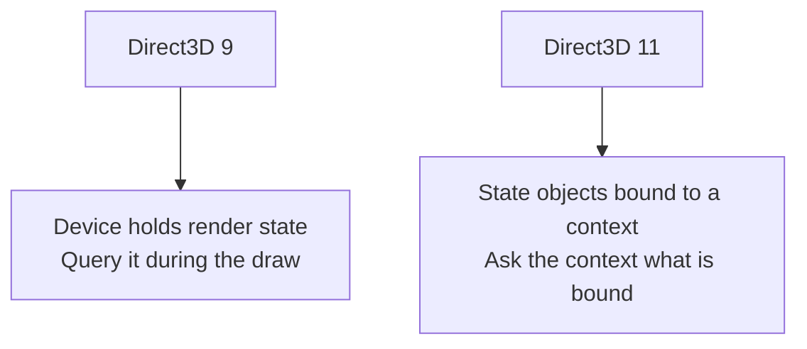
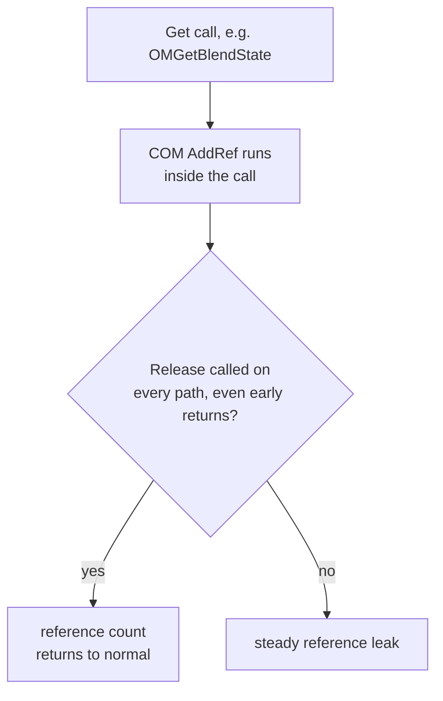

import CodeTrace from '../../../../components/CodeTrace.astro';
import LiveCells from '../../../../components/LiveCells.astro';
import PredictReveal from '../../../../components/PredictReveal.astro';
import MemoryStrip from '../../../../components/MemoryStrip.astro';
import MarginNote from '../../../../components/kit/MarginNote.astro';

## A draw call is still a request, not an object

Lesson 7.3 made this point for OpenGL and it holds here: a draw call asks the
GPU to consume indices using whatever is currently bound. It does not say
"draw the player." One character can take several draws — body, weapon, shadow
— and one draw can cover many unrelated objects batched together.

What changes between the two APIs is not that idea. It is how much of the
surrounding state you can see from inside the call.

## Read the arguments precisely

The Direct3D 11 indexed draw looks compact because buffers, shaders, and
topology are already bound to the context. Its function type has the hidden
COM object pointer first, followed by a count and two offsets. Those three
numbers choose geometry within the bound buffers; they do not identify a
game object by themselves:

```rust
type DrawIndexedFn = unsafe extern "system" fn(
    context: *mut c_void,        // the hidden `this`
    index_count: u32,
    start_index_location: u32,
    base_vertex_location: i32,
);
```

| Argument | Meaning |
|---|---|
| `index_count` | how many indices to read from the bound index buffer |
| `start_index_location` | where in that buffer to begin |
| `base_vertex_location` | a value added to every index after it is read |

<PredictReveal
  id="c3-draw-indexed"
  setup="The bound index buffer holds six indices: 0, 1, 2, 2, 1, 3. The game calls DrawIndexed(3, 3, 4), so index_count is 3, start_index_location is 3 and base_vertex_location is 4."
  question="Which vertices does the GPU fetch?"
  options={[
    { label: 'Vertices 3, 4 and 5', why: 'Those are the buffer positions that are read, not vertices. The GPU reads the indices stored at positions 3, 4 and 5, which are 2, 1 and 3, and then adds the base.' },
    { label: 'Vertices 2, 1 and 3', why: 'Those are the indices read from positions 3 to 5, but base_vertex_location adds 4 to every index after it is read.' },
    { label: 'Vertices 6, 5 and 7', correct: true, why: 'Start at position 3 and read 3 indices: 2, 1, 3. Adding the base vertex 4 to each gives 2 + 4 = 6, 1 + 4 = 5 and 3 + 4 = 7.' },
  ]}
>

<LiveCells lab="draw-indexed-fetch" />

</PredictReveal>

Imagine two `DrawIndexed(6, 0, 0)` calls in one frame. Before the first, the
context has a character texture and depth testing bound. Before the second,
the program binds a UI texture and a state that ignores world depth. The same
three draw arguments can now produce different images. If the character's
triangles are hidden behind a wall, the first call may produce no visible
pixels at all. The draw arguments tell you which indices were submitted; the
bound buffers, topology, shaders, textures, and depth state explain how those
indices are used. This is the state-bound idea from OpenGL again, with
Direct3D's own way of storing and querying the state.

<CodeTrace trace="handoff-draw-bound-state" />

Note that `base_vertex_location` is **signed**. That is not a quirk; it exists
so several meshes can share one vertex buffer, with each mesh addressed by a
positive or negative shift from a common origin. If you log it as `u32` a
perfectly ordinary negative offset appears as a number near four billion, and
you will be tempted to treat a normal draw as corrupt.

<MemoryStrip
  cells="=FF|=FF|=FF|=FF"
  groups="0-3:as `i32`: −1, an ordinary negative vertex shift"
  groups2="0-3:misread as `u32`: 4,294,967,295"
  caption="For example, `base_vertex_location = −1`. The bits never change; only the reading does."
/>

The same arithmetic from Lesson 7.3 applies to the counts:

```text
index_count / 3 = triangles submitted, for a triangle list
index_count / 3 ≠ triangles you can see
index_count     ≠ unique vertex count
```

Submitted triangles can still be degenerate, back-face culled, clipped, or
covered by something nearer. Depth testing happens long after this call
returns.

The Direct3D 9 equivalent carries more:

```text
DrawIndexedPrimitive(
    primitive_type,      // triangle list, strip, fan, line list...
    base_vertex_index,
    min_vertex_index,
    num_vertices,
    start_index,
    primitive_count      // primitives, not indices
)
```

Two differences matter when you port a note from one to the other.
`primitive_count` counts **primitives**, where Direct3D 11's `index_count`
counts **indices** — for a triangle list they differ by a factor of three, and
mixing them up is the most common reason a ported filter matches nothing.
`primitive_type` is an argument in Direct3D 9; in Direct3D 11 the topology is
bound state set earlier by `IASetPrimitiveTopology`, so the draw call does not
mention it at all.

## Where the state lives is the real difference



Direct3D 9 keeps render state on the device as a large set of individually
settable values. Inside a `DrawIndexedPrimitive` hook you can ask the device
what is currently set — `GetRenderState`, `GetTexture`, `GetTransform` — and
get an answer immediately.

Direct3D 11 replaces most of that with immutable state objects created up
front and bound as a unit: a blend state, a depth-stencil state, a rasterizer
state. From a `DrawIndexed` hook you retrieve what is bound with the context's
`Get` calls — `OMGetBlendState`, `OMGetDepthStencilState`, `PSGetShader`,
`IAGetVertexBuffers` — and then read the description back off the object.

<MarginNote kind="alternative">Direct3D 11 state objects are saved configuration bundles: the context binds a bundle, and a draw uses whichever bundle is currently attached.</MarginNote>

Two practical consequences follow, and they catch people out:

**Those `Get` calls hand you a reference.** COM `Get*` methods call `AddRef`
on what they return, increasing the object's reference count by one. Each
successful query therefore creates one matching `Release` obligation. On a
path that runs thousands of times per second, forgetting even one release
causes a steady leak. Put the returned pointer in a Rust wrapper whose
`Drop` calls `Release`; then an early return cannot skip cleanup. Lesson 11.6
later applies the same ownership idea to Windows handles.



**Querying costs more than logging.** Retrieving several state objects per
draw, on a thread with a frame deadline, is real work. Sample rather than
record everything — one draw in a hundred, or only draws whose index count
falls in a range you care about.

## Label geometry by the state bound around it

You cannot ask a draw call what it is drawing. You can group draws by
properties that tend to correlate with what they are, then test whether the
grouping holds:

| Observable | What it often distinguishes |
|---|---|
| bound pixel shader | material family: skin, foliage, UI, particles |
| bound texture | a specific asset |
| index count | large static geometry versus small dynamic meshes |
| depth-stencil state | world geometry versus UI drawn without depth |
| blend state | opaque geometry versus transparent effects |
| draw order within a frame | rendering passes: depth, opaque, transparent, UI |

Every one of these is a **proxy**: an observable clue that may correlate with
the category we care about, without being the category itself. A shader shared
by characters and crates does not distinguish them. Lesson 13.7 later returns
to the risks of treating a proxy as proof.
Test a grouping by changing something you control — move, equip a different
weapon, walk into another room — and check that the group changes the way the
label says it should. A label that matched in one frame can be an accident of
what that frame happened to draw.

<MarginNote kind="brief">Draw properties are category clues that need testing, rather than proof that a particular game object was drawn.</MarginNote>

## Shader programs and the cost of a draw

The bound pixel shader in the table above is one compiled program among many
that a game can choose from, and the number of draws in a frame has a cost of
its own.

### Variants, instancing, and shaders that do not draw

- **Variants.** One shader source can have switches, written as `#ifdef` lines, such
  as "has a normal map" or "has fog." Each combination compiles to a separate
  program, so three switches give 2 × 2 × 2 = 8 variants. Engines compile the ones a
  scene needs, which is why a game can hitch the first time something new appears.
- **Instancing.** To draw 1,000 copies of one tree mesh, the game makes one draw call
  with 1,000 *instances*. A buffer holds each copy's transform, a 4 × 4 matrix of 16
  four-byte floats, which is 64 bytes, so 1,000 copies take 64,000 bytes. Earlier we saw
  that one draw can contain many objects; instancing is the deliberate version of it.
- **Compute shaders.** A compute shader is not part of drawing. It is a general GPU
  program that runs once for each item in a grid of work, reading and writing buffers.
  Engines use it for particles, culling, mesh deformation, and post-processing.
- **Post-processing shaders.** A fragment shader run over a full-screen rectangle, reading
  the finished picture as a texture, produces effects such as bloom and colour grading
  (Lesson 7.2).
- **Extending the standard material.** Engines let a game add its own shader code and
  extra vertex data, such as a per-vertex wind weight, to a standard material instead of
  rewriting it.

### Why many small draws cost frame time

Each draw call costs the CPU something even if the GPU's share is tiny, because the
driver checks the bound state and builds the commands. Suppose, as an illustration, one
draw costs 5 microseconds of CPU time. Then 10,000 draws cost 10,000 × 5 = 50,000
microseconds, which is 50 ms, three frames of the 16.67 ms budget from Lesson 4.1, with
the GPU waiting. Instancing, merging meshes that share a material, texture atlases, and
culling (Lesson 7.2) all exist to cut the number of draws.

A **stress test** finds the limit by multiplying one thing, such as cubes, sprites,
lights, animated characters, or text, and watching the frame time. If 1,000 cubes take
4 ms and 4,000 take 16 ms, each costs 0.004 ms and the 16.67 ms budget runs out at about
16.67 ÷ 0.004 = 4,167 cubes. Halving the window's pixel count tells you which processor
is the limit: if the frame time does not change, the CPU, not the GPU, is the bottleneck.

## Draw a frame boundary around your samples

`DrawIndexed` fires many times per frame; `Present` fires once. Recording draws
without frame boundaries produces a stream you cannot reason about, because you
cannot tell where one frame's ordering ends.

Number the frames in the `Present` hook from Lesson 7.10, and tag each draw
sample with the current frame number. The draw index within a frame is then
meaningful, which is what makes "the UI is the last eleven draws" a statement
you can check rather than an impression.

<MarginNote kind="narration">Without frame numbers, a late UI draw from one frame can appear next to an early world draw from the next, hiding their real order.</MarginNote>

<MemoryStrip
  column
  cells="draw 0..38=depth pre-pass, no pixel shader|draw 39..174=opaque world geometry|draw 175..190=transparent effects, blending enabled|draw 191..201=UI, depth test disabled"
  caption="Frame 412's draws, grouped by what the bound state implies. The boundaries come from watching blend and depth-stencil state change, not from asking the draw call what it drew."
/>

Bound both the samples per frame and the frames retained, exactly as in Lesson 4.11. An unbounded recorder attached to a render loop will consume memory faster
than you expect and will change the frame times you were trying to measure.

## Direct3D 12 moves the work earlier

Direct3D 12 does not submit draws through a context. Commands are recorded into
command lists ahead of time and handed to a queue with `ExecuteCommandLists`,
often built on several threads at once.

Hooking the submission point therefore tells you that a batch of pre-recorded
work was queued, not what is in it. `Present` still works as a frame boundary
because the swap chain interface is unchanged, but per-draw observation means
dealing with recorded command lists rather than intercepting individual calls.
The vtable reasoning from Lesson 7.10 transfers directly; the assumption that
one hook sees one draw does not.

## Scope

Use your own Direct3D program or an offline single-player session on a pinned
version, and keep the analysis window separate as in Lesson 7.9. The
transferable skill — reading submitted GPU work and correlating it with bound
state — is what graphics debuggers, frame profilers, and capture tools do, and
it is the practical way to understand what a renderer is actually asking the
GPU to do.

Lesson 7.12 uses these graphics observations alongside memory snapshots,
feature toggles, and verified restoration and shutdown order to assemble one reliable local tool.
