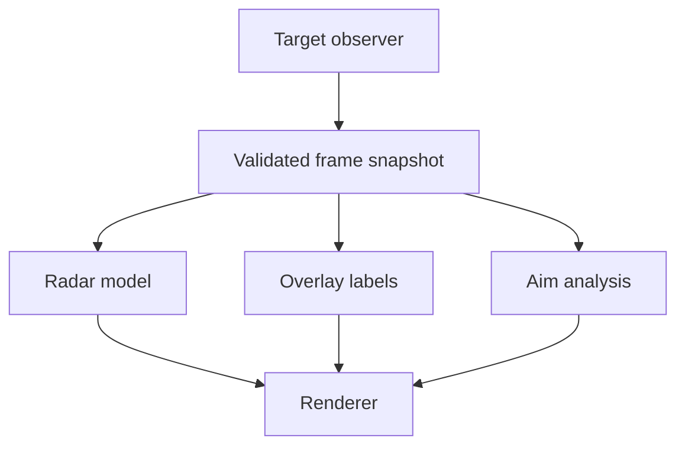
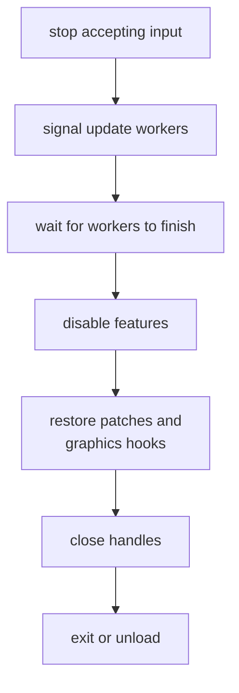

import Frame from '../../../../components/kit/Frame.astro';
import CellFrames from '../../../../components/CellFrames.astro';
import { frameBundleCells } from '../../../../data/figure-cells-b';
import { Accordion, GitHub } from '../../../../components/kit';
import MemoryStrip from '../../../../components/MemoryStrip.astro';
import SortBoard from '../../../../components/SortBoard.astro';
import MarginNote from '../../../../components/kit/MarginNote.astro';


The [tool-architecture lesson](/pages/8/10/) gave snapshots, commands,
features, and cleanup separate owners. Rendering adds a timing constraint:
positions and the camera that projects them must describe the same captured
update. A well-organized tool can still draw incorrect markers if those values
come from different moments.

This lesson applies that architecture to radar, overlays, aim analysis, and
render hooks. The snippets describe interfaces inside a combined tool; the
complete dispatcher and patch owners are linked below.


## One frame, one snapshot



Read and validate target data once per update. Features consume the same owned
snapshot. In this excerpt, `PlayerSnapshot` is a local record of the player's
identity, position, and other validated fields; `Mat4` holds the camera
transform. Neither type borrows a pointer into the game:

```rust
struct FrameSnapshot {
    local: PlayerSnapshot,
    players: Vec<PlayerSnapshot>,
    matrix: Mat4,
    viewport: (f32, f32),
}
```

Every feature receives the same owned set of fields from one bounded
observation pass. If the radar reads the player list on one pass while the
overlay independently reads the camera matrix a few milliseconds later, the
features describe different updates, and markers can land where enemies used
to be. Bundling the fields means both features use the same captured values.
It does **not** make the reads atomic: the game can update an entity between
two reads within that pass. Validate the resulting snapshot and, if the game
exposes a tick or generation counter, check it before and after the copy or
retry when it changes.

<MarginNote kind="brief">Sharing one captured set prevents features from using different copies; it does not prove the game stayed unchanged during capture.</MarginNote>

The camera matrix and viewport travel with the players for that exact reason.
Projecting this frame's positions through last frame's camera is wrong in a way
that looks almost right — everything is drawn slightly behind where it belongs,
worst when you turn quickly, which makes it easy to blame the projection maths
instead of the timing.

`Vec<PlayerSnapshot>` is owned rather than borrowed, so nothing here points back
into the game. A feature holding a reference into an entity the game then frees
is the stale-pointer failure from Lesson 1.8, arriving through the back door.
Copy once, then let every feature read from the copy.

<CellFrames id="shared-frame-bundle" title="One snapshot, two readers" scenarios={frameBundleCells} />

<SortBoard board="snapshot-contents" label="Explore what belongs in a frame snapshot" />

## Give render features a lifecycle

A radar overlay needs a different per-frame action from a recoil patch, but
both must answer the same lifecycle questions: when is it enabled, what does
it do with this frame's snapshot, and how does it undo its own changes? The
interface below makes those moments explicit for every feature:

```rust
trait Feature {
    fn name(&self) -> &'static str;
    fn enable(&mut self) -> anyhow::Result<()>;
    fn update(&mut self, frame: &FrameSnapshot) -> anyhow::Result<()>;
    fn disable(&mut self) -> anyhow::Result<()>;
}
```

Only patching or hooking features need setup or restoration in `enable` and
`disable`. A pure observer still implements those required methods, but they
can return `Ok(())`; its useful work lives in `update`. The owner checks the
result before reporting that a toggle succeeded.

## Model configuration with enums

Three booleans named `show_teammates`, `show_opponents`, and
`show_everyone` could all become true after a sequence of clicks. Yet the
overlay can display only one of those modes at a time. Store that choice as
one enum value, alongside the independent radar and debug switches:

<MarginNote kind="alternative">Use one selector for mutually exclusive overlay modes, and separate switches for independent features that can operate together.</MarginNote>

```rust
#[derive(Clone, Copy, Debug, Eq, PartialEq)]
enum OverlayMode {
    Off,
    Teammates,
    Opponents,
    Everyone,
}

#[derive(Debug)]
struct Settings {
    overlay: OverlayMode,
    show_radar: bool,
    show_debug_values: bool,
}
```

An enum prevents impossible combinations such as three different overlay booleans being true at the same time.

## Route input as commands

A key press should request a change, not let the input thread reach into a
feature while the update loop is using it. The input side can send a small
command; the update loop then applies it to its own `Settings`. For example,
`CycleOverlay` takes `Off` to `Teammates` and eventually back to `Off`:

```rust
enum Command {
    ToggleRadar,
    CycleOverlay,
    ToggleDebugValues,
    Stop,
}

// The update loop uses true to leave the loop and enter cleanup.
fn apply_command(settings: &mut Settings, command: Command) -> bool {
    match command {
        Command::ToggleRadar => settings.show_radar = !settings.show_radar,
        Command::CycleOverlay => {
            settings.overlay = match settings.overlay {
                OverlayMode::Off => OverlayMode::Teammates,
                OverlayMode::Teammates => OverlayMode::Opponents,
                OverlayMode::Opponents => OverlayMode::Everyone,
                OverlayMode::Everyone => OverlayMode::Off,
            };
        }
        Command::ToggleDebugValues => {
            settings.show_debug_values = !settings.show_debug_values;
        }
        Command::Stop => return true,
    }
    false
}
```

The input thread sends commands through a channel. The update loop owns and
changes the settings, avoiding shared mutable globals. A `true` return means
it should stop taking frames and enter cleanup. The menu receives an
acknowledgement after an enabled feature has actually changed state.

## Contain a render feature's failure

If a frame lacks a valid projection matrix, the overlay may fail while the
radar and debug reader can continue. Each feature's `update` returns a result.
The owner records the error, marks that feature disabled, and calls its
restoration path. Subsequent updates skip it; an error message alone would
leave it running again on the next frame.

That local decision is valid only when the rest of the snapshot remains sound.
A closed process or an invalid entity list stops every consumer. A missing
camera may disable only screen projection. If a failing feature cannot restore
its hook or patch, keep that failure visible and enter the shared shutdown
path rather than treating a disabled checkbox as successful cleanup.


## Shut down in reverse order



Do not unload code while another thread may still execute it. Restoration must
also happen on the thread or render boundary that owns the changed state.
Stop the worker, wait for it to finish, and remove only the hooks this tool
installed. A render callback may still be executing after the menu closes.

<MarginNote kind="narration">Closing the controls can leave a render callback in flight. Removing its code before that call finishes turns cleanup into a crash.</MarginNote>

## Keep verified graphics facts with their target build

An offset is a fact about one supported executable, not a universal property
of an overlay. A profile joins build identity, module-relative locations,
object layouts, and expected instruction bytes. Each feature receives verified
facts from that profile rather than embedding another copy of an address.

A profile should make the supported game and version obvious. These constants join the concrete labs used by this combined tool; the complete project uses `Option<usize>` for facts a game does not need.

```rust
const ASSAULTCUBE_1202: TargetFacts = TargetFacts {
    process: "ac_client.exe",
    local_player_ptr: Some(0x0050_9B74),
    entity_list_ptr: Some(0x0050_F4F8),
    entity_count: Some(0x0050_F500),
    trigger_call: Some(0x0040_AD9D),
    no_recoil_patch: Some(0x0045_BAAD),
    radar_patch: Some(0x0040_9FB3),
    esp_hook: Some(0x0040_BE7E),
    draw_elements_hook_offset: None,
};

const URBAN_TERROR_434: TargetFacts = TargetFacts {
    process: "Quake3-UrT.exe",
    local_player_ptr: None,
    entity_list_ptr: None,
    entity_count: None,
    trigger_call: None,
    no_recoil_patch: None,
    radar_patch: None,
    esp_hook: None,
    draw_elements_hook_offset: Some(0x16),
};
```

At startup, verify an original instruction signature at every address you plan to use. The finished DLL dispatches by the current executable and exposes only hotkeys that belong to that exact game:

| Target | F1 | F2 | F3 | F4 | F5 |
|---|---|---|---|---|---|
| Wesnoth 1.14.9 | terrain gold cave | second-player stat text | reveal map | — | — |
| AssaultCube 1.2.0.2 | triggerbot | no recoil | reveal radar | aimbot | internal ESP |
| Urban Terror 4.3.4 | memory wallhook | OpenGL wallhack | OpenGL chams | — | — |

**End** stops the worker and restores every active patch. Flare and Wyrmsun, the offline automation targets from Chapter 4, use their dedicated in-game loops instead of this function-key table.

Load one supported profile after fingerprinting the target. Features receive
verified addresses and layouts instead of hardcoding them. If a profile has
no address for a capability, that control must remain unavailable; `None` is
not an invitation to reuse an address from another game.

The complete dispatcher and lifecycles are in [`dll.rs`](/windows-labs/src/windows_impl/dll.rs). The patch-owning primitives are in [`local_patch.rs`](/windows-labs/src/windows_impl/local_patch.rs); dropping each `LocalPatch` restores the bytes it captured only after an exact pre-patch verification.

<GitHub path="windows-labs/src/windows_impl/dll.rs" />

<GitHub path="windows-labs/src/windows_impl/local_patch.rs" />

## Build the Urban Terror 4.3.4 memory wallhack

The flag trace and frame-local state model in
[Lesson 7.2](/pages/5/02/#search-for-the-flag) can be understood with the
debugger alone. This pinned in-process implementation applies the verified
detour and DLL lifecycle from [Lesson 6.4](/pages/8/03/) to the rendering
boundary. Keep those ownership and restoration steps intact while following
the exact build-specific addresses below.

<Accordion title="Exact-build reference: the Urban Terror 4.3.4 memory wallhack">

The `r_drawentities` trace in this exact build leads through the call at `0x0052F71F`. Inside the entity loop, `ebx` holds the current render entity at `0x0052D2FD`. The field at `[ebx+4]` cycles through values such as `0x0D`, `0x40`, `0x82`, and `0x83`.

Hook this exact point:

```text
hook:    0x0052_D2FD
resume:  0x0052_D303
change:  write 0x0D to dword ptr [ebx+4]
replay:  mov dword ptr [0x0102_AE98], ebx
```

A 32-bit detour cave has the same shape as the Wesnoth cave:

```rust
#[cfg(target_arch = "x86")]
#[unsafe(naked)]
unsafe extern "C" fn render_flag_cave() {
    core::arch::naked_asm!(
        "pushfd",
        "pushad",
        "mov dword ptr [ebx + 4], 0x0D",
        "popad",
        "popfd",
        "mov dword ptr [0x0102_AE98], ebx",
        "jmp {resume}",
        resume = const 0x0052_D303,
    );
}
```

Install a six-byte verified detour at `0x0052D2FD`, enter a local game, enable `cg_thirdperson`, and add bots. The local player and bots should render through walls, as in
[Lesson 7.2's depth-test experiment](/pages/5/02/#depth-testing-in-plain-english). Values `0x83` and `0x40` should not create the same effect; that comparison is how you prove `0x0D` is the relevant render state.

Restore the original six hook bytes when the feature is disabled. This memory-based wallhack is intentionally kept as a full target-specific lab before the more general OpenGL approach below.

The DLL already contains the complete verified implementation. Build and inject it into `Quake3-UrT.exe`, enter a local bot match, and press **F1** to toggle this memory wallhook. Press **End** to stop and restore all six bytes. See [`install_urban_terror_memory_wallhook`](/windows-labs/src/windows_impl/game_hooks.rs) and the Urban Terror hotkey worker in [`dll.rs`](/windows-labs/src/windows_impl/dll.rs).

<GitHub path="windows-labs/src/windows_impl/game_hooks.rs" />

<GitHub path="windows-labs/src/windows_impl/dll.rs" />

</Accordion>

## What the experiment proves

The comparison isolates how one CPU-side flag changes GPU behavior. It does not prove that every build uses the same flag, address, or rendering path, so keep the executable fingerprint and original bytes beside the result.

## Turn the wrapper into the actual Urban Terror wallhack

The API signature, draw-count interpretation, and sampling design in
[Lesson 7.3](/pages/5/03/) stand on their own. The exact-build detour below applies the DLL and patch lifecycle
from [Lesson 6.4](/pages/8/03/) to one verified OpenGL instruction. Recheck
the displaced instruction span and restoration path before running it.

<Accordion title="Exact-build reference: the Urban Terror 4.3.4 OpenGL wallhack">

In Urban Terror 4.3.4, resolve `glDrawElements` from `opengl32.dll`. The historical build hooks the instruction at **`glDrawElements + 0x16`** and resumes six bytes later. This is not a function-entry wrapper: it is a real code cave in the middle of the OpenGL function. At this point in this 32-bit build, `EBX` holds `count`.

Resolve these two OpenGL functions with `GetProcAddress`:

```rust
type GlDepthFunc = unsafe extern "system" fn(function: u32);
type GlDepthRange = unsafe extern "system" fn(near: f64, far: f64);

const GL_LEQUAL: u32 = 0x0203;
const GL_ALWAYS: u32 = 0x0207;
```

[Lesson 7.3](/pages/5/03/#restore-graphics-state) explains why this pair matters:
`glDepthRange(0.0, 0.0)` flattens every highlighted fragment to the nearest depth,
and `GL_ALWAYS` stops the depth test from rejecting it.

The six bytes we replace are one whole x86 instruction:

```text
8B B6 18 0A 00 00    mov esi, dword ptr [esi + 0xA18]
```

Before and after the patch, the six bytes at `glDrawElements + 0x16` look like
this:

<MemoryStrip
  cells="+0x16=8B|+0x17=B6|+0x18=18|+0x19=0A|+0x1A=00|+0x1B=00"
  groups="0-1:mov into `esi` from `[esi + displacement]`|2-5:displacement `0xA18`, lowest byte first"
  caption="Before: one whole instruction. Read lowest byte first, `18 0A 00 00` is 0x18 + 0x0A × 256 = 24 + 2,560 = 2,584, which is `0xA18`."
/>

<MemoryStrip
  cells="+0x16=E9|+0x17=??|+0x18=??|+0x19=??|+0x1A=??|+0x1B=90"
  marks="0-4"
  groups="0-4:`jmp` to the cave: `E9` plus a 4-byte distance|5-5:`nop`"
  caption="After: the four `??` bytes hold the distance from `+0x1B`, the byte right after the jump (0x16 + 5 = 0x1B), to the cave, so they depend on where the DLL loaded. The cave returns to `+0x1C` (0x16 + 6 = 22 + 6 = 28 = 0x1C), so the `nop` never runs; it only fills the sixth byte so no fragment of the old instruction is left behind."
/>

The installer refuses to patch if those bytes do not match. It writes a five-byte near jump plus one `NOP`, and `LocalPatch` owns the saved bytes so dropping the patch restores them:

```rust
let draw_elements = resolve(opengl, s!("glDrawElements"))?;
let hook = draw_elements.checked_add(0x16)
    .context("glDrawElements hook address overflowed")?;
DRAW_RETURN.store(hook + 6, Ordering::Release);

const ORIGINAL: [u8; 6] = [0x8B, 0xB6, 0x18, 0x0A, 0x00, 0x00];
let jump = near_jump(hook, urban_terror_opengl_cave as *const () as usize)?;
let mut replacement = [0x90_u8; 6];
replacement[..5].copy_from_slice(&jump);
let patch = LocalPatch::apply(hook, &ORIGINAL, &replacement)?;
```

The cave saves the CPU flags and all general-purpose registers, passes the live `EBX` value to an ordinary helper, replays the displaced instruction, and returns to the byte immediately after it:

```rust
#[unsafe(naked)]
unsafe extern "C" fn urban_terror_opengl_cave() {
    core::arch::naked_asm!(
        "pushfd",
        "pushad",
        "push ebx",
        "call {apply}",
        "add esp, 4",
        "popad",
        "popfd",
        "mov esi, dword ptr [esi + 0xA18]",
        "jmp dword ptr [{resume}]",
        apply = sym apply_urban_terror_gl_state,
        resume = sym DRAW_RETURN,
    );
}
```

Why save everything? The original OpenGL function expects its registers and flags to have particular values when it resumes. The compiler is free to use registers while `apply_urban_terror_gl_state` runs. Saving and restoring them makes the helper almost invisible to the interrupted function.

The helper changes the live OpenGL state. A later non-highlighted draw restores normal depth state:

```rust
extern "C" fn apply_urban_terror_gl_state(count: u32) {
    let highlighted = OPENGL_MODE.load(Ordering::Acquire) != OPENGL_OFF
        && count > 500;

    // 🛡️ SAFETY: these pointers were resolved from this process's opengl32.dll,
    // and the game reached the cave on its OpenGL render thread.
    unsafe {
        if highlighted {
            depth_range(0.0, 0.0);
            depth_func(GL_ALWAYS);
        } else {
            depth_range(0.0, 1.0);
            depth_func(GL_LEQUAL);
        }
    }
}
```

Build the DLL for 32-bit Windows, inject it into `Quake3-UrT.exe`, enter a local match, and press **F2**. Geometry with `count > 500` is forced to the near plane and uses `GL_ALWAYS`, producing the player/weapon-through-wall result shown below. Press **F2** again or **End** to restore normal state and the original six code bytes.

```powershell
cargo build --release --target i686-pc-windows-msvc
.\target\i686-pc-windows-msvc\release\injector.exe `
  Quake3-UrT.exe `
  .\target\i686-pc-windows-msvc\release\gha_windows_labs.dll
```

The complete compiled implementation—including export lookup, the naked cave, exact-byte verification, both graphics modes, and restoration—is in [`opengl_hooks.rs`](/windows-labs/src/windows_impl/opengl_hooks.rs). The hotkey worker is in [`dll.rs`](/windows-labs/src/windows_impl/dll.rs).

<GitHub path="windows-labs/src/windows_impl/opengl_hooks.rs" />

<GitHub path="windows-labs/src/windows_impl/dll.rs" />

<Frame caption="The wallhack after count filtering, in the offline lab.">


</Frame>

The threshold is a confirmed property of this lesson build, not a universal player detector. Log counts while toggling third-person and adding/removing bots so you can see exactly which models it includes.

OpenGL state stays set until another call changes it. This middle-of-function cave cannot surround one typed `glDrawElements` call, so it restores the normal state when the next non-highlighted draw arrives and when the feature is disabled. Pressing **End** also disables the mode before removing the code patch. That ordering prevents the game from being left with `GL_ALWAYS` active.

</Accordion>

## Check the combined render path

The complete dispatcher and feature lifecycles bring the separate effects
into one DLL, called the **multihack** in the original course. Test the
connections as well as each effect:

- radar and overlay consumers use the same captured player values;
- camera and viewport changes cannot silently mix with an older frame;
- a disabled feature is skipped until the user deliberately enables it again;
- each render callback restores the graphics state it changed;
- each hook restores only its own verified original bytes;
- an unsupported game or build exposes no active feature controls;
- shutdown waits for workers and callbacks before unloading code.

Keep a log of target, build, feature, address, expected bytes, found bytes,
action, and restoration result, separate from the visible menu. Those records
let a failed cleanup remain inspectable even after its UI closes.

The next lesson draws the menu inside the game's frame. Each feature still needs one owner, commands that report their outcome, and verified restoration of any changed bytes.
